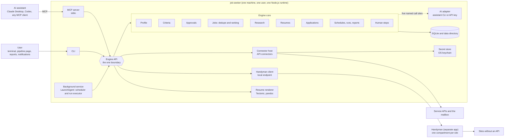

# job-seeker design

- **Status:** revised after the design review, for the build. Nothing in this document is built yet.
- **Companion:** [execution-plan.md](execution-plan.md) turns this design into phases, MCP first.
- **Layout:** the predecessor `jobseek` code now lives at this repository's root with its history. Paths in section 11 use that layout.

## 1. Decisions at a glance

1. **One engine, local and single-user, in TypeScript.** The whole of job-seeker is TypeScript on Node.js: the engine core, the API connectors, the Handyman client, the MCP server and the CLI. The migrated Python code is ported, and its tests are the behavioural spec for the port. One runtime keeps the install simple and matches Command Center (CC), whose cc-foundation and cc-engine are TypeScript. State lives in one SQLite database plus a data directory outside the repository. There are no accounts, roles or sharing.
2. **One boundary.** Every caller goes through the **Engine API**: the MCP server, the CLI and the background service. It is a versioned set of JSON-schema'd commands, queries and events, and it is the surface cc-engine's extension API can wrap later. job-seeker never imports CC code.
3. **MCP is the main way in.** The MCP server is a local process that the assistant starts over stdio. There is no network transport for now. Every capability is reachable as an MCP tool, and every build phase is accepted through the MCP interface (see the execution plan).
4. **Connectors follow CC's connector model.** A connector is a package with a `connector.json` manifest that uses CC's fields. It declares capability contracts such as `jobs.search@1`. API connectors are TypeScript modules that run in the engine process. **Browser connectors are Handyman compartments.** Handyman is the standalone Electron desktop app that runs each site in an isolated compartment with the user's real sign-ins, trusted input, per-site rate caps, working hours and a stop-everything-at-the-first-warning rule. A browser connector in job-seeker is a thin adapter that satisfies its contracts by calling the matching compartment over Handyman's local endpoint (section 7). job-seeker has no browser host of its own.
5. **The background service runs in the user's own login session.** It is a macOS LaunchAgent, so it can show notifications, read the user's keychain and run the user's assistant CLI, and it sits on the same machine as Handyman. A run step on a browser source that hits a login or a captcha is reported by the compartment; job-seeker pauses the step, records the human step and notifies the user, and the user clears it in Handyman (section 7). The MCP process hands runs to the service, and runs them in-process only when the service is down.
6. **AI is compartmentalised.** Model calls go through one **AI adapter**, which uses the user's own assistant CLI (such as Claude Code or Codex) or an API key, as set in config. Only five named places may call it, and each can be switched off: profile intake, unattended match review, resume tailoring, research synthesis and criteria proposals (section 13). Everything else is deterministic, and every model output passes a deterministic check before it is kept.
7. **Ranking is rule-based first.** Rule scores rank every job unattended. Judgement scores, from the user's assistant over MCP or from the AI adapter's match review, are stored next to them.
8. **Nothing consequential happens without approval.** Criteria changes and LinkedIn profile edits are created as pending **approval records**. The user approves with a plain yes in chat (the assistant then calls a tool), in the CLI, or through MCP elicitation where the client supports it. Every decision is recorded (section 9.1).
9. **LinkedIn is the first browser source,** on the user's main account, through Handyman's LinkedIn compartment. job-seeker searches, reads job details, reads the user's own profile and alerts, and updates the user's own profile through the compartment's actions. Every profile write is shown as a diff and applied only after approval. It never messages, sends connection requests or applies. Handyman enforces the site's rate caps; page views are capped at 200 a day.
10. **One install.** One npm package, then `job-seeker setup`, which checks that Handyman is installed and reachable, installs a bundled Tectonic for LaTeX, the background service, and the MCP configuration for Claude Desktop and Codex (section 12.6).

## 2. The design principle, per capability

The assistant does what needs judgement or writing, in conversation with the user. job-seeker keeps the durable state and does what needs a machine that is always on, logged in and exact. When no assistant is connected, the AI adapter can do a small, named part of the judgement work, and its output is checked the same way.

| # | Capability | The assistant does (over MCP) | The AI adapter may do (switchable) | job-seeker provides and persists |
|---|---|---|---|---|
| 1 | Profile intake | Reads the extracted source text and proposes claims. Discusses edits with the user | Turns a resume or LinkedIn profile text into evidenced claims | Text extraction from PDF, DOCX, LaTeX, free text and the LinkedIn profile. Stored sources. Versioned profile documents. Rejects a claim whose evidence quote does not match its source |
| 2 | API connectors | Nothing at run time | Nothing | Connector registry, manifests, scoped HTTP, secrets, health |
| 3 | Browser connectors | Tells the user when a human step is waiting | Nothing | The Handyman client, the thin per-site adapters, the human-step record and notification. Handyman owns the profiles, sign-ins, pacing and the human-step hand-off |
| 4 | Search by criteria | Optional judgement scores for top matches | Reviews top matches after a scheduled run | Criteria sets, query mapping, dedupe, rule ranking, provenance |
| 5 | Market research | Weighs the findings and explains them to the user | Writes a synthesis of a research run | Dated, evidence-backed aggregates over collected jobs and connector data |
| 6 | Criteria changes | Proposes changes and asks the user | Proposes changes from research, always as pending approvals | Proposals, approval records and the audit trail |
| 7 | Resumes | Selects and phrases claims for one job | Selects and phrases real claims for one job | Template registry, a deterministic grounding audit by claim ID, LaTeX and .docx output, and resume records |
| 8 | LinkedIn profile edits | Drafts an edit with the user | Nothing | Reads the live profile, shows the diff, grounds it against the profile claims, applies it only after approval, then verifies it |
| 9 | Schedules and reports | Nothing (reports are readable without it) | Nothing | Background service, runs, JSON and HTML reports, the pipeline page |
| 10 | MCP server | Is the client | Nothing | Tools, resources, prompts and elicitation |
| 11 | Applying | Fills in the employer's form and submits it, then reports back | Nothing | The application packet (job details, apply URL, tailored resume, "why me" note) and the tracker states |

job-seeker has no chat UI, email writer or form filler. Workflows that used to be Claude Code commands become MCP prompts, which any MCP client can run.

## 3. Component map



**Processes.** There is no network listener. Processes share state through the database and the data directory.

| Process | Started by | Role |
|---|---|---|
| `job-seeker service` | The LaunchAgent, in the user's login session (section 12.1) | The only scheduler. Executes queued and scheduled runs, sends notifications, runs maintenance |
| `job-seeker mcp` | The assistant, over stdio | Serves MCP. It never schedules. It queues runs for the service, and executes a run itself only when the service is down |
| `job-seeker` (CLI) | The user | Setup, secrets, approvals, reports, the pipeline page |
| Handyman | The user, or its own background mode | A separate app, outside job-seeker. Runs every browser compartment and serves them on its local endpoint |
| AI adapter backend | Spawned per call by the engine, when the configured backend is an assistant CLI | Runs one non-interactive call with no tools, then exits |

**Concurrency.** SQLite runs in WAL mode with short write transactions. A run is claimed with a lease row (owner, expiry, heartbeat), so the service and an MCP process never execute the same run. Each binding runs one step at a time. Handyman serialises each compartment's browser session.

**Run hand-off.** An MCP tool that starts work (`search_run`, `alerts_ingest`, `linkedin_profile_apply` and so on) writes a `queued` run and touches `run/wake` in the data directory. The service watches that file and its own 30-second schedule tick, and writes its heartbeat every 5 seconds, separately from the tick. If the service's heartbeat is older than 15 seconds, the MCP process takes the run's lease and executes it in-process instead. If the MCP client disconnects mid-run, the lease expires and the next executor resumes the run from its step cursors. A tool can wait up to 60 seconds for a short run; otherwise it returns the run ID and the assistant follows it with `run_status`.

### 3.1 Technology choices

| Concern | Choice | Notes |
|---|---|---|
| Runtime | Node.js 22 LTS or later | One runtime for every component |
| Language | TypeScript, `strict` | Compiled to JavaScript for the npm package |
| Database | SQLite through Node's built-in `node:sqlite`, with `better-sqlite3` as the fallback | Chosen in phase 1 by a short check of WAL, `VACUUM INTO` and prebuilt availability; recorded in `docs/decisions/` |
| MCP | The official TypeScript SDK, stdio transport | Tools, resources, prompts and elicitation |
| Browser work | Handyman compartments, reached over Handyman's local endpoint | job-seeker runs no browser of its own (section 7) |
| Secrets | The OS keychain through a maintained native binding, with an encrypted-file fallback | Section 5.5 |
| Schemas | JSON Schema, validated at every boundary | The same schemas generate the TypeScript types |
| Tests | Vitest, plus an MCP test client over stdio | Section 3 of the execution plan |
| LaTeX | Tectonic, a pinned build downloaded and checksum-checked by `setup` | Bundled, so the user installs no TeX distribution |
| .docx | pandoc, when the user has it | Optional. `setup` reports whether it is present |

## 4. The engine boundary

- **Shape.** The engine exposes named operations. Each one has a kind (command or query), a risk (`read`, `write_internal`, or `write_external` for an action that changes something outside job-seeker, such as a LinkedIn profile edit), and an input and output JSON Schema under `schemas/engine/v1/`. MCP tools, CLI commands and service jobs are thin adapters generated from or checked against that table, so there is one source of truth. A `write_external` operation can only execute an approved approval record.
- **Versioning.** `ENGINE_API = 1`. A breaking change adds `v2` schemas and keeps `v1` working for one minor release.
- **Events.** Every state change appends a domain event, such as `job.found`, `job.scored`, `criteria.changed`, `approval.decided`, `linkedin.profile_edit_applied`, `application.state_changed`, `human_step.opened` and `run.finished`. Events are stored in an `events` table with a monotonic cursor. Reports read from it, and a later integration can sync from it.
- **How CC can wrap it later (not built now):**
  1. Call the Engine API through job-seeker's MCP server, run as a local server with an allowlist of tools.
  2. Load job-seeker's connector manifests, which already use CC's fields. Connectors are TypeScript written against a CC-shaped context, so moving one is a re-host.
  3. Consume `job.posting@1` records and the events feed as a "company" data source.

## 5. Data model

### 5.1 Where data lives

The data directory is `~/Library/Application Support/job-seeker` on macOS, `%LOCALAPPDATA%\job-seeker` on Windows and `$XDG_DATA_HOME/job-seeker` on Linux, or wherever `JOB_SEEKER_HOME` points. job-seeker refuses to start if the directory is inside a git work tree, so private data cannot be committed by accident.

```text
<data dir>/
  jobseeker.db                 # SQLite (WAL), schema version in PRAGMA user_version
  config.json                  # settings, including the AI adapter's backend and switches
  sources/<source_id>.<ext>    # profile source documents and their extracted text
  resumes/<resume_id>/         # resume.tex, resume.pdf, resume.docx, why-me.md, build.log
  reports/<yyyy>/<mm>/<run_id>.json|.html   # one report per run
  reports/latest.html, reports/pipeline.html
  tools/tectonic/              # the pinned Tectonic build
  run/wake                     # touched to wake the service
  backups/                     # database snapshot taken before each migration
  logs/                        # redacted, rotated
```

Browser profiles, cookies and page captures live with Handyman, not in this directory.

### 5.2 Entities

| Entity | Key fields | Notes |
|---|---|---|
| `profile_sources` | id, kind (`resume_pdf`, `resume_docx`, `resume_latex`, `resume_text`, `free_text`, `linkedin_profile`, `public_page`, `user_statement`), sha256, stored path, extracted text, imported_at | Immutable. Claims cite text spans in these |
| `profile_versions` | version, parent, document (`profile@1`), created_by (`user`, `assistant`, `ai_adapter`, `import`), note, created_at | Immutable. The highest version is current. A revert saves an old document as a new version |
| `criteria_sets` / `criteria_versions` | set id, name, status; version, body (`criteria@1`), change_id | Every version comes from an approved change |
| `criteria_changes` | id, kind (`create`, `modify`, `archive`), target, proposed body or patch, proposed_by (`user`, `assistant`, `ai_adapter`, `research:<run_id>`, `profile:<version>`), evidence refs, approval id, status (`proposed`, `approved`, `rejected`, `superseded`) | Append-only. Rejected proposals are kept |
| `approvals` | id, subject kind (`criteria_change`, `linkedin_profile_edit`), subject id, payload sha256, summary, status (`pending`, `approved`, `rejected`, `superseded`, `expired`), requested_by, requested_at, decided_by, channel (`chat`, `cli`, `mcp_elicitation`), user words, decided_at | **The one approval record** (section 9.1). An approval is bound to its payload's hash |
| `linkedin_profile_edits` | id, section (`headline`, `about`, `experience:<entry>`, `skills`), before (as read, with its source id), after, diff, grounding audit, approval id, status (`proposed`, `approved`, `applying`, `applied`, `verified`, `failed`, `superseded`, `rejected`), applied_at, verify source id | Section 7.6 |
| `jobs` | id, dedupe key, canonical URL, title, company, location, workplace, salary, seniority, description (guarded, untrusted), `partial`, first_seen, last_seen, status (`active`, `unreachable`, `expired`) | One row per real posting after dedupe |
| `job_sightings` | job id, connector, binding, external id, raw URL, run id, criteria set, record (`job.posting@1`), seen_at | Provenance: every source of every job |
| `job_features` | job id, skills, normalised title, certifications, salary figures | Small and kept after descriptions are pruned, so research evidence stays valid |
| `job_scores` | job id, profile version, criteria version, method (`rule`, `assistant`, `ai_review`), score 0-100, band, gate verdicts, dimension scores, reason, scored_at | Every method is kept. Section 8 says which one is shown |
| `research_runs` / `research_findings` / `research_notes` | run (profile version, window, inputs, created_at); finding (kind, subject, metrics, n, evidence refs); note (author, text, finding refs) | Dated, so findings can be compared over time. A synthesis from the AI adapter is a note |
| `templates` | id, name, output (`latex`, `docx`), path, sha256, page budget, licence | Synced from `templates/` in the repository |
| `resumes` | id, job id, template id and sha, profile version, content (items with claim IDs), audit result, PDF and .docx paths, "why me" note path, created_at | Each item traces to claims, and each claim to source spans |
| `applications` / `application_events` | job id, current state, resume id; event (from, to, at, reported_by, channel, note) | States: `found`, `shortlisted`, `resume_prepared`, `applied`, `interview`, `offer`, `rejected` |
| `schedules` | id, kind (`search`, `alerts`, `research`, `match_review`, `maintenance`), targets, schedule (interval, cron or manual), time zone, enabled, next_run_at | Survives restarts because it lives in the database |
| `runs` / `run_steps` | run (kind, trigger, status, lease, report id); step (connector, binding, criteria set, status, cursor, counts, redacted error) | Run statuses: `queued`, `running`, `waiting_for_human`, `succeeded`, `partial`, `failed`, `cancelled` |
| `connector_bindings` | id, connector id and version, settings, secret refs, health (`ok`, `degraded`, `needs_human`, `auth_expired`, `failing`, `disabled`) | One binding per connector and account. For a browser connector the health mirrors what the Handyman compartment last reported |
| `human_steps` | id, binding or compartment, run step, reason, detail, what the user should open, opened_at, notified_at, resolved_at, resolution | **The one needs-human signal** (section 7.4) |
| `ai_calls` | id, purpose, backend, model, input refs, prompt sha256, output, validation result, duration, status, at | Every model call, kept for audit |
| `events` | cursor, type, entity, payload, at | Section 4 |

### 5.3 Documents and evidence

The profile, criteria, reports and records are JSON documents. Each carries its own `schema` tag (`profile@1`, `criteria@1`, `report@1`, `job.posting@1`) and has an upgrade function. A profile claim must cite evidence:

```json
{
  "schema": "profile@1",
  "claims": [
    {
      "id": "clm_skill_pricing",
      "type": "skill",
      "value": "B2B pricing strategy",
      "evidence": [
        { "source_id": "src_resume_2026_11", "start": 1180, "end": 1251,
          "quote": "Led the pricing redesign for a B2B analytics product across 3 regions" }
      ]
    }
  ]
}
```

job-seeker rejects a version whose quotes do not match their source spans (whitespace is normalised). This applies whoever proposed the claims: the user, the assistant or the AI adapter. A fact the user states in conversation is first recorded as a `user_statement` source, and claims then cite it. The example person, product and figures are fictional.

### 5.4 Schema versions and migrations

1. `PRAGMA user_version` holds the schema version. Migrations are forward-only files, `store/migrations/NNNN_<name>.sql` or `.ts` for data moves, and each runs in a transaction.
2. Before migrating, job-seeker writes `VACUUM INTO backups/jobseeker-v<N>-<timestamp>.db`. It refuses to open a database newer than it understands and asks the user to upgrade.
3. Tests migrate an empty database to the latest version, and every stored fixture snapshot (one per released schema version) to the latest.
4. `job-seeker import-legacy` reads the predecessor's `state/seen_jobs.json`, `state/last_run.json` and `tracker.csv` and records what it imported. It is repeatable and idempotent until phase 8 of the execution plan: each run merges newly seen jobs and tracker rows and skips what it already imported. From phase 8 it stops accepting new imports.

### 5.5 Secrets

- **Storage.** API keys and OAuth tokens go in the OS keychain (macOS Keychain, Windows Credential Manager, the Linux Secret Service) through a maintained native binding. Where no keychain backend exists, they go in an encrypted file whose key file sits outside the data directory with mode 0600. That fallback protects against accidental copies and backups, not against someone using the same OS account, and setup says so.
- **Entry.** Secrets are entered only through the CLI (`job-seeker secrets set`, or `job-seeker connect gmail`, which runs the OAuth loopback flow in the system browser). They never pass through MCP, so the model never sees them. This includes an API key for the AI adapter.
- **Browser cookies and sign-ins** stay with Handyman's compartments; job-seeker never sees them. (Section 7.)
- **Redaction.** Logs, reports and AI adapter inputs pass through a redactor that masks every stored secret value. Cookie and authorization headers are never logged.

## 6. Connector contract

### 6.1 Kinds

| | API connector | Browser connector |
|---|---|---|
| Talks to | A service API over HTTPS, or the mailbox through the `mailbox@1` contract | A Handyman compartment, which talks to the site in the user's signed-in session |
| Code | TypeScript module with `ctx.http` and `ctx.mailbox` | TypeScript module with `ctx.handyman`, a client for one compartment |
| Sign-in | `api_key`, `oauth2` or `none` | Owned by Handyman: one saved sign-in per site, in the compartment |
| Hosted by | The connector host, in the engine process | The connector host, in the engine process; the browser itself runs in Handyman |

### 6.2 Manifest

A connector's `connector.json` uses CC's manifest fields: `manifestVersion`, `id`, `name`, `version`, `kind`, `description`, `implements`, `auth`, `permissions`, `actions` (each with a risk class, schemas, idempotency and an optional rate limit), `syncs`, `records`, `settingsSchema`, `browser` (for a browser connector: the Handyman compartment it needs, the site's origins and a `selectorsVersion`), `limits` and `flags` (`tos_risk`, `unofficial_surface`, `beta`). job-seeker's additions all sit under one key, `x-jobseeker`, so a CC port can move or drop them:

- `requires`: contracts the connector consumes, such as `mailbox@1`;
- `mail.senders`: the only senders an alert connector may read;
- `noFetchHosts`: portal hosts whose postings must never be fetched, because their terms forbid it;
- `market`: for example `us` or `in`;
- `manualOnly`: actions that may run only on a direct user request, never from a schedule (LinkedIn people search).

An action with risk `write_external` also declares `"confirmation": "approval"`. The host refuses to run it without an approved approval record whose payload hash matches the call.

```json
{
  "manifestVersion": 1,
  "id": "adzuna",
  "name": "Adzuna job search API",
  "version": "0.1.0",
  "kind": "api",
  "description": "Searches Adzuna's official API with a saved criteria set.",
  "implements": ["jobs.search@1", "market.stats@1"],
  "auth": { "method": "api_key", "inject": { "in": "query", "name": "app_key" },
            "instructions": "Register a free developer account, then run: job-seeker secrets set adzuna.app_key" },
  "permissions": { "network": { "hosts": ["api.adzuna.com"] },
                   "records": { "write": ["job.posting@1", "market.stat@1"] },
                   "secrets": { "custom": false } },
  "actions": [
    { "name": "search_jobs", "title": "Search jobs", "risk": "read", "idempotent": true,
      "confirmation": "policy", "rateLimit": { "perMinute": 20 },
      "inputSchema": { "$ref": "contracts/jobs.search@1#/input" },
      "outputSchema": { "$ref": "contracts/jobs.search@1#/output" } }
  ],
  "syncs": [],
  "records": ["job.posting@1", "market.stat@1"],
  "settingsSchema": { "type": "object", "required": ["app_id", "country"],
                      "properties": { "app_id": { "type": "string" }, "country": { "type": "string" } } },
  "limits": { "timeoutSeconds": 60, "maxMemoryMb": 256, "minSyncIntervalMinutes": 60 },
  "flags": [],
  "x-jobseeker": { "market": "us" }
}
```

### 6.3 Capability contracts

The engine calls contracts, never a specific connector.

| Contract | Members | Record | Used by |
|---|---|---|---|
| `jobs.search@1` | action `search_jobs({criteria, filters}) -> {records, unsupported, next}` | `job.posting@1` | Search runs (capability 4) |
| `jobs.recommended@1` | action `recommended_jobs({limit})` | `job.posting@1` | Search from the site's own profile-based recommendations |
| `jobs.alerts@1` | sync `alerts(cursor)` | `job.posting@1` | Alert ingest |
| `jobs.detail@1` | action `get_job({url or externalId})` | `job.posting@1` with its description | Detail fetch for top candidates |
| `profile.read@1` | action `read_own_profile()` | `profile.source@1` | Profile intake (capability 1), and the "before" of a profile edit |
| `profile.write@1` | action `apply_profile_edit({section, after, expectedBefore})`, risk `write_external` | `profile.edit_result@1` | LinkedIn profile edits (capability 8) |
| `market.stats@1` | action `market_stats({query, kind})` | `market.stat@1` | Research (capability 5) |
| `mailbox@1` | actions `list_messages({senders, since})` and `get_message(id)`, read-only | `mail.message@1` | Alert connectors, through `ctx.mailbox` |
| `tracker.export@1` | action `export_applications({since})` | none | Notion sync |

- **Records.** `job.posting@1` keeps CC's core fields (title, company, location, URL, source, posted time, and a description marked untrusted). It adds `workplace`, `salary {min, max, currency, period, predicted}`, `seniority`, `employment_type`, `apply_url`, `partial` and `employer_hidden`.
- **Criteria.** `search_jobs` receives the normalised criteria fields plus that connector's own `filters`, validated against the action's `inputSchema`. It returns the criteria fields it could not apply as `unsupported`, and the engine applies those after the search. Alert connectors take no query, because the user sets up alerts on the portal. Criteria sets filter and rank their results instead.

### 6.4 Runtime API

```ts
interface ConnectorContext {
  run: RunInfo;                 // run id, connector, version, binding, action or sync, deadline
  settings: Readonly<Record<string, unknown>>;  // validated against settingsSchema
  http?: ScopedHttp;            // API connectors: HTTPS only, hosts from permissions.network.hosts, auth injected by the host
  handyman?: HandymanCompartment; // browser connectors: one compartment over Handyman's local endpoint
  mailbox?: Mailbox;            // only with x-jobseeker.requires mailbox@1; read-only, limited to mail.senders
  state: KeyValue;              // per-binding cursor store, at most 64 KB
  clock: Clock;                 // injectable, for deterministic tests
  emit(record: ConnectorRecord): void;                           // validated against the record schema
  log(level: LogLevel, msg: string, fields?: object): void;      // redacted by the host
  needsHuman(reason: HumanReason, detail: string): never;
}
```

`needsHuman` reasons are `signed_out`, `challenge`, `two_factor`, `consent_screen`, `unexpected_page` and `auth_expired`. These match CC's set.

### 6.5 Rules

1. **No AI in connectors.** Connectors make no model calls and no judgement calls. A static check fails any connector that imports the AI adapter or an AI SDK, or names an AI provider host.
2. **Determinism.** The same fixture input, settings, cursor and clock give byte-identical output and records.
3. **Credentials stay with the host.** An API connector never receives a raw secret; the host injects authentication into requests. A browser connector never receives a cookie or credential at all: the sign-in lives in Handyman's compartment, and only records and compartment status cross the endpoint.
4. **Untrusted text.** Text from services passes `posting_guard` at ingest. MCP returns it wrapped as `{"untrusted_page_content": ...}`, and the AI adapter receives it only inside a marked untrusted block.
5. **Site rules.**
   - Postings are fetched only through the `web-posting` connector, which enforces robots.txt and skips every `noFetchHosts` entry.
   - API hosts follow their API terms and are not robots-gated.
   - Rate limits and pacing come from the manifest, and a binding may only tighten them. For a browser connector the manifest's limits are the budget job-seeker plans against; Handyman's own per-site caps, working hours and stop-at-first-warning rule always apply on top (section 7.5).
6. **External writes need approval.** An action with risk `write_external` runs only with an approved, hash-matched approval record, and never from a schedule.
7. **The testing kit.** `job-seeker connector test <id>` runs offline and checks:
   - the manifest against its schema;
   - the static checks;
   - fixture tests for every action and sync (a browser connector's fixtures run against a fake Handyman endpoint, the same shape `linkedin/client.py`'s tests already use);
   - determinism;
   - that a compartment's needs-human report (sign-in wall, challenge) leads to a human step, never a retry loop;
   - that every `write_external` action refuses to run without a matching approval;
   - fixture hygiene: no real names, emails, phone numbers, tokens or cookies.

### 6.6 Registry: adding a source

Each connector lives in `connectors/<id>/` with `connector.json`, its code (`index.ts`; a browser connector is a thin adapter over the Handyman client), `fixtures/`, `tests/` and a `README.md` that says what it does and what it never does. The registry is `connectors/registry.json`: one entry per connector with id, version and enabled flag. **Adding a source means adding one directory and one registry line.** A test fails if a directory is unregistered, or if a registry entry has no directory.

### 6.7 The initial connectors

| id | Kind | Implements | Origin |
|---|---|---|---|
| `linkedin` | browser (Handyman compartment) | `jobs.search@1`, `jobs.recommended@1`, `jobs.detail@1`, `jobs.alerts@1`, `profile.read@1`, `profile.write@1` | Handyman's LinkedIn compartment (section 7.5) |
| `gmail` | api (oauth2, read-only scope) | `mailbox@1` | `tools/gmail_alerts.py` |
| `linkedin-alerts`, `indeed-alerts`, `ladders-alerts`, `employer-alerts` | api (mailbox) | `jobs.alerts@1` | `gmail_alerts.py` link extraction, `sources/registry.py`, `alert-sources.json` |
| `web-posting` | api (robots-gated GET) | `jobs.detail@1` | `tools/fetch_page.py`, `robots_check.py`, `page_decode.py` |
| `adzuna` | api (api_key) | `jobs.search@1`, `market.stats@1` | Adzuna API portal issue |
| `naukri-alerts`, `iimjobs-alerts`, `execthread-alerts`, `builtin-alerts` | api (mailbox) | `jobs.alerts@1` | The four alert-email portal issues. Each portal's host goes in `noFetchHosts` |
| `github-public` | api (none) | none: an action that reads public repositories, used by `profile_expand_scan` | `expand/tools/github_source.py` |
| `notion` | api (api_key) | `tracker.export@1` | `tools/notion_client.py`, `notion_sync.py` |

WhatsApp is not in v1. Naukri, iimjobs and any other browser-only site join the same way LinkedIn does: as a Handyman compartment plus one thin connector here, when a job-search use appears (section 7.8 lists what that needs from Handyman).

## 7. Browser work through Handyman

Every piece of job-seeker's work that touches a website through a browser runs as a **Handyman compartment**. Handyman is a standalone Electron desktop app (its own repository and design): it runs each site in an isolated compartment with the user's real sign-ins, trusted input, per-site rate caps, working hours and a stop-everything-at-the-first-warning rule. One host for all site work means one set of safety rules per site, one sign-in per site, and one connector shape. job-seeker has no browser host, no browser profiles and no Playwright dependency of its own.

### 7.1 The split

- **Handyman owns everything that touches a website through a browser:** each site (LinkedIn today; Naukri, iimjobs or any other browser-only site when one is needed) is a Handyman compartment. Profiles, cookies, sign-ins, pacing, rate caps, working hours, challenge detection and the human-step hand-off all live there, under Handyman's rules.
- **job-seeker owns the job-search records and logic:** profile, saved searches, jobs seen, applications, ranking, research, resume tailoring, the AI adapter and the MCP server. Official-API connectors (for example Adzuna) keep running in job-seeker's own engine, since they need no browser.

### 7.2 The endpoint and the connector adapter

Handyman serves its compartments on a local-only endpoint, the same shape the predecessor's `linkedin/client.py` already uses for LinkedIn: a UNIX socket with mode 0600 under Handyman's user-data directory on macOS and Linux, a named pipe on Windows, speaking newline-delimited JSON-RPC. The endpoint is resolved from Handyman's user-data directory, with an environment override for tests.

- **One client.** The engine has one Handyman client module. It never launches Handyman, never touches a credential, and turns every transport failure or compartment-reported "needs you" into a specific, actionable error - never a raw socket or timeout traceback and never a retry loop.
- **A browser connector is a thin adapter.** It keeps the connector contract unchanged: it declares `implements: ["jobs.search@1", ...]` in its manifest, and its TypeScript module maps each contract action onto the compartment's actions through `ctx.handyman`. From the engine's side a search on LinkedIn and a search on Adzuna look the same: a contract call that returns `job.posting@1` records. Criteria mapping, `unsupported` reporting and result validation happen in the adapter, exactly as for an API connector.
- **Records cross, pages don't.** Only contract records, counters and compartment status cross the endpoint. Posting descriptions pass `posting_guard` at ingest like every other untrusted text.

### 7.3 The lifecycle of a browser step

1. **Sign in, once, in Handyman.** The user signs in to each site by hand in that site's Handyman compartment. job-seeker never sees the credential, and a compartment's sign-in survives restarts because Handyman owns the profile.
2. **Run.** A run step on a browser connector calls the compartment through the client. Handyman paces the session - one page load at a time, its per-site caps and working hours - and enforces them even if job-seeker asks for more.
3. **Needs human.** When the compartment reports a sign-in wall, a challenge, two-factor or an unexpected page, the adapter raises `needsHuman`: the step is paused with its cursor, a `human_steps` row is written, the user is notified, and the report's "Waiting for you" section names the site, the reason and the remedy: open Handyman and clear the step in that compartment. job-seeker opens no window itself; the window is Handyman's, and job-seeker types nothing into any browser.
4. **Resume.** Once the compartment reports the session healthy again, the waiting step resumes from its cursor on the next run. The user can also mark the step done from the CLI after clearing it.
5. **Time-out and stop.** A step left waiting past its limit ends as `needs_human` and the run as `partial`. While a compartment reports needs-human, later runs skip that connector and list it again under "Waiting for you". Handyman's stop-everything-at-the-first-warning rule applies inside the compartment at all times; job-seeker adds no retry loop against the site.

If the user is away, the notification and Handyman's own surface are waiting when they return; nothing proceeds until they act.

### 7.4 One needs-human signal

`human_steps` is the only record of "waiting for you", for browser compartments and for everything else that needs a person: an expired OAuth token, a keychain that denies access, an AI adapter backend that is signed out, or a compartment that reports a challenge. Every surface reads that table:

- the report's and the pipeline page's "Waiting for you" section;
- the MCP `status` tool and the `jobseeker://human-steps` resource;
- `job-seeker status`;
- the OS notification.

### 7.5 Guards, pacing and the LinkedIn compartment

The browser guards are Handyman's, applied to every compartment: the user's real sign-in per site, trusted input only, per-site rate caps and working hours, no evasion, and stop-everything-at-the-first-warning. job-seeker never solves a CAPTCHA, types a credential or answers a security check - it has no browser to do it with. job-seeker's own rules still apply to what crosses the endpoint: untrusted text passes `posting_guard`, and connectors make no AI calls (section 6.5).

The `linkedin` connector is the first browser connector, an adapter over Handyman's LinkedIn compartment. The compartment reuses the vendored app's extractors, URL builders, pacing defaults, result cache, failed-parse captures and the "LinkedIn needs you" detection; the predecessor keeps reading LinkedIn through the same compartment (`linkedin/client.py`) until phase 8 of the execution plan. It uses the user's main account.

| Need | Action | Notes |
|---|---|---|
| Job search with saved criteria | `search_jobs` | Criteria map to LinkedIn's keyword box and its experience-level, workplace, date-posted and job-type filters. Pagination stops at the limit |
| Jobs LinkedIn recommends for the profile | `recommended_jobs` | Reads the signed-in account's recommended-jobs collection |
| Job details | `get_job` | Fetched only for the top candidates of a run, within the daily budget |
| The person's own profile | `read_own_profile` | Stored as a `linkedin_profile` source for intake, and as the "before" of an edit |
| Job-alert results | `alerts` sync | Lists the account's alerts, then replays each alert's search. LinkedIn's alert emails remain a second route through `linkedin-alerts`, which needs no session |
| Own-profile edits | `apply_profile_edit` | Risk `write_external`. Section 7.6 |
| People search | `search_people` | Read-only and `manualOnly`: one MCP tool, `linkedin_search_people`, on a direct user request. A schedule that names it is refused |
| Save job | `save_job` | The compartment's write. Not exposed |

Messaging, connection requests and applying do not exist as actions.

**Budget.** At most 200 page loads a day (the user's local day) and 40 an hour, one at a time with a 3 to 7 second gap - configured as the compartment's caps in Handyman, which enforces them. A planner in job-seeker, shared by all criteria sets and schedules, spends the day's budget in this order: human-requested calls, profile reads and edits, alerts, saved searches, then details for top candidates. Whatever does not fit is deferred, and the report says so. Handyman's caps are the hard limit whatever the planner asks for, and its counters are what the report shows.

The binding is created only after the user accepts its `tos_risk` flag. Section 18 of the execution plan covers the LinkedIn risks.

### 7.6 LinkedIn profile edits

1. **Draft.** In chat, the assistant drafts an edit with the user and calls `linkedin_profile_propose({section, after})`. v1 supports the headline, the About section, the description of an existing experience entry, and adding or removing skills.
2. **Read and diff.** job-seeker reads the live section (`read_own_profile`), stores it as a source, and builds a diff of before and after. It checks LinkedIn's field length limits.
3. **Ground.** The deterministic grounding audit from resumes runs on the new text: numbers, dates, titles, employers and tools must appear in the current profile's claims or their evidence. A failure blocks the proposal and names the token. To add a new fact, the user first states it, and it is recorded as a `user_statement` source.
4. **Approve.** The proposal becomes a pending approval record showing the diff. The user approves it (section 9.1). An approval binds to the payload's hash, so any change to the text needs a new approval.
5. **Apply.** `linkedin_profile_apply({approval_id})` queues a run. Before writing, the compartment reads the section again; if it no longer matches the diff's "before", the edit is `superseded` and the user is asked again. The edit runs through the compartment's trusted input, at the same pace as reads, using LinkedIn's own edit form, with the compartment visible so the user can watch it. At most 5 edits a day.
6. **Verify.** After saving, the compartment reads the section again and compares it with the approved text. A match marks the edit `verified`. A mismatch, or an edit form that no longer matches the compartment's selectors, stops the edit, opens a human step and leaves the approved text ready for the user to paste in Handyman's window.

The diff tells the user that LinkedIn may share some profile changes with their network, depending on the user's own LinkedIn setting. job-seeker does not change that setting. A binding setting, `profileWrites: assisted`, turns step 5 into "the compartment opens the edit form and shows the approved text" so the user saves by hand; it is the fallback if automated edits prove risky.

### 7.7 When Handyman is not running

A scheduled, unattended run that needs a browser source requires Handyman to be running (open or in the background). job-seeker treats an unreachable endpoint as a **skipped source, never a failure and never a retry loop**:

1. **Probe once per step.** Before a browser step, the client probes the endpoint. If Handyman is not running, or the compartment is absent, the step is marked `skipped` with the reason `handyman_unreachable` and the run moves on.
2. **API sources still run.** A skipped browser step does not hold up the rest of the run: Gmail alerts, Adzuna, `web-posting` and every other API connector execute normally, and the run finishes `partial` when something was skipped.
3. **The report says so plainly.** The skipped sources are named in the report's connector section and summary, with one line of remedy: start Handyman and re-run, or wait for the next scheduled run. `status` and the pipeline page show the same, so the gap is visible without opening the report.
4. **No catch-up storm.** The next scheduled run probes again and runs the browser steps if Handyman is back; a missed schedule still fires once, not once per missed slot (section 10.1). Nothing queues up against a site.

A run started by hand from MCP or the CLI behaves the same way, but the tool's answer says immediately that Handyman is not running, so the user can start it and ask again.

### 7.8 What job-seeker needs from Handyman

Requirements that fall out of this split, for Handyman's own roadmap (nothing here is built by job-seeker):

1. **A compartment action surface** per browser site that covers the contracts the adapter maps: for LinkedIn, job search with filters, recommended jobs, job details, job alerts, own-profile read, own-profile edit and people search.
2. **Status and needs-human signalling** over the endpoint: reachable, signed-in state, challenge or sign-in wall with a reason, and per-site page-load counters for the day and hour.
3. **Enforced per-site caps, pacing, working hours and the stop-at-first-warning rule** inside each compartment, whatever the caller asks for.
4. **Availability for scheduled runs:** Handyman running (open or in the background) when job-seeker's schedules fire, or browser sources are skipped per section 7.7.
5. **New compartments** (for example Naukri or iimjobs) when a browser-only site gains a job-search use; each then gets one thin connector here.

## 8. Search, dedupe and ranking

1. **Collect.** Search steps run `jobs.search@1` for each selected connector and criteria set, and `jobs.recommended@1` where a criteria set asks for it. Alert steps run `jobs.alerts@1`. Every record is stored as a `job_sightings` row.
2. **Dedupe.** The ported `url_canon` and `job_key` code merges sightings into `jobs` by canonical URL, then by company and title. A job keeps every source.
3. **Guard and detail.** Descriptions pass `posting_guard`. For the top candidates by rule score, `jobs.detail@1` fills in descriptions. A job with no fetchable detail is scored from what its alert says and flagged `partial`.
4. **Rule score, always.** Gates come first, and any gate failure vetoes the job:
   - exclusions;
   - seniority, comparing title signals with the criteria;
   - location and workplace;
   - a salary floor, applied when the salary is known.

   Weighted dimensions follow (title, skills against profile evidence, domain, seniority and location), with weights per criteria set. This ports `rank_state`'s gates, bands and unreachable-retry rules.
5. **Judgement score, optional.**
   - **Assistant:** the MCP prompt `review_matches` asks the assistant to score the top matches on the rubric dimensions, and `rank_submit` stores them as method `assistant`.
   - **AI adapter:** when match review is switched on, a `match_review` step after a scheduled run sends the top matches to the adapter, and the same validation stores them as method `ai_review`.

   Both go through `rank_state`'s apply path: weights and vetoes apply, and a judgement score can never lift a job that a gate vetoed.
6. **What is shown.** The newest judgement score is shown when it was made for the current profile version and the job has not changed since. Otherwise the rule score is shown. Every list labels which one it is.

### 8.1 Searching from the LinkedIn profile

"Search with my LinkedIn profile" chains existing parts:

1. `profile_read_linkedin` reads the own profile and stores it as a source.
2. Profile intake turns it into claims, through the assistant in chat or the AI adapter, and the user saves a profile version.
3. `criteria_from_profile` derives a draft criteria set deterministically: target titles from the current and recent roles, the top evidenced skills as keywords, and the profile's location and workplace preferences. It is created as a pending approval.
4. Once approved, `search_run` runs it on LinkedIn (`search_jobs`) together with LinkedIn's own recommendations for the account (`recommended_jobs`), and ranks the results against the profile.

## 9. MCP surface

The MCP server is the TypeScript SDK's stdio server. Each tool is an adapter over one Engine API operation. Tool descriptions tell the assistant when to ask the user first.

| Capability | Tools | Resources and prompts |
|---|---|---|
| 1 Profile | `profile_import_source` (file path, or pasted text from an attachment), `profile_read_linkedin`, `profile_intake_run` (AI adapter), `profile_get`, `profile_save_version`, `profile_add_statement`, `profile_diff`, `profile_expand_scan` | `jobseeker://profile/current`, `jobseeker://profile/versions/{n}`, `jobseeker://profile/sources/{id}`; prompt `intake_profile` |
| 2, 3 Connectors | `connectors_list` (with each browser connector's compartment state as Handyman last reported it), `connector_configure` (no secrets), `human_steps_list`, `linkedin_search_people` (manual only) | `jobseeker://connectors`, `jobseeker://human-steps` |
| 4 Search | `criteria_list`, `criteria_get`, `criteria_from_profile`, `search_run` (saved sets or one unsaved criteria body), `alerts_ingest`, `run_status`, `jobs_list`, `job_get`, `jobs_search`, `rank_submit`, `match_review_run` (AI adapter) | `jobseeker://criteria/{id}`, `jobseeker://jobs/{id}`; prompt `review_matches` |
| 5, 6 Research and criteria | `research_run`, `research_get`, `research_list`, `research_compare`, `research_annotate`, `research_synthesize` (AI adapter), `criteria_propose` | `jobseeker://research/latest`; prompt `review_research` |
| Approvals | `approvals_list`, `approval_get`, `approval_decide` | `jobseeker://approvals/pending` |
| 7 Resumes | `templates_list`, `resume_prepare`, `resume_tailor` (AI adapter), `resume_render` (PDF or .docx), `resume_get`, `resumes_list`, `why_me_prepare` | `jobseeker://templates`; prompt `tailor_resume` |
| 8 LinkedIn profile | `linkedin_profile_get`, `linkedin_profile_propose`, `linkedin_profile_apply`, `linkedin_profile_edits_list` | prompt `edit_linkedin_profile` |
| 9 Schedules and reports | `schedules_list`, `schedule_set`, `schedule_delete`, `reports_list`, `report_get`, `pipeline_page` | `jobseeker://reports/latest`, `jobseeker://reports/{id}` |
| 11 Applications | `application_prepare` (job details, apply URL, resume paths, "why me" note), `application_set_state`, `applications_list`, `application_get`, `notion_sync` | prompt `apply_to_job` |
| All | `status`: service state, next runs, waiting human steps, pending approvals, failing connectors, AI adapter state | |

### 9.1 Approvals

Criteria changes and LinkedIn profile edits are created as pending approval records. Nothing they describe happens until the record is approved. A record can be decided through three channels, which all write the same record:

1. **Chat.** The user says yes in the conversation, and the assistant calls `approval_decide({id, decision, user_words})`. The tool description tells the assistant to call it only after the user's explicit answer to that specific approval, and to pass the user's own words. Channel `chat`.
2. **MCP elicitation.** Where the client supports elicitation, `approval_decide` (and a proposing tool, when asked to) first asks the user directly with the diff, and the user's answer decides. Channel `mcp_elicitation`.
3. **CLI.** `job-seeker approvals list|show|approve|reject <id>`. Channel `cli`.

Rules:

- An approval binds to the sha256 of its payload. Changing the payload supersedes the record.
- A pending record expires after 14 days. Rejected and expired records are kept.
- A record whose target changed first (a newer criteria version, or a profile section that no longer matches its "before") is superseded.
- The AI adapter can create proposals but can never decide one.
- The pipeline page, reports and `status` list pending approvals.

**The whole flow from Claude Desktop or Codex.** With LinkedIn signed in once in Handyman's compartment: `profile_read_linkedin`, `profile_save_version`, `criteria_from_profile`, `approval_decide`, `search_run`, `jobs_list`, `linkedin_profile_propose`, `approval_decide`, `linkedin_profile_apply`, then `research_run`, `criteria_propose`, `schedule_set`, `resume_prepare`, `resume_render`, `application_prepare` and `application_set_state`.

**Compatibility.** The predecessor's Python MCP server keeps working under its own configuration until the port retires it (execution plan, section 4). From phase 8 it is trimmed to the tools not yet replaced (`tailor` and `upskill_report`), and it is removed once phases 9 and 10 have both shipped. The new server uses the new tool names only.

## 10. Scheduler, reports and the pipeline page

### 10.1 Scheduler

- **Schedules.**
  - Kinds: `{kind: interval, minutes}`, `{kind: cron, expr, timeZone}` (five-field) and `{kind: manual}`. Time zones are IANA names.
  - A schedule can never fire more often than any target connector's `minSyncIntervalMinutes`.
  - A schedule can never include a `manualOnly` action or a `write_external` action.
- **Defaults created by `job-seeker setup`:**
  - alert ingest every 4 hours;
  - saved-criteria search daily at 07:00;
  - match review after each scheduled search, when the AI adapter's match review is on;
  - research weekly on Monday;
  - maintenance weekly.
- **Firing.**
  - The service checks due schedules every 30 seconds and adds plus or minus 10 percent jitter.
  - After sleep, log-out or downtime it runs a missed schedule once, not once per missed slot. The service runs only while the user is logged in, which is the price of working in the user's session.
  - Each schedule has at most one active run.
- **Runs.** A run is a list of steps, one per connector, binding and criteria set. The steps run independently: a LinkedIn human step does not hold up Adzuna.
- **Retries.** Retries apply only to idempotent actions, after network errors, HTTP 429 or 5xx, with backoff at 1, 5 and 25 minutes. A binding that fails 3 runs in a row becomes `failing` and opens a human step.

### 10.2 Report format

Every run writes `reports/<yyyy>/<mm>/<run_id>.json` (`report@1`) and a matching `.html` page. The HTML is self-contained, works offline and escapes all untrusted text. Each run also refreshes `reports/latest.html` and the pipeline page. `job-seeker report open` opens the latest report without any assistant.

```json
{
  "schema": "report@1",
  "run": { "id": "run_01JD3Q", "kind": "search", "trigger": "schedule", "schedule_id": "sch_daily_search",
           "started_at": "2026-12-01T07:00:04Z", "finished_at": "2026-12-01T07:09:41Z", "status": "partial" },
  "profile_version": 7,
  "criteria": [ { "id": "crs_product_remote", "name": "Product leadership, remote", "version": 3 } ],
  "summary": { "new_jobs": 12, "merged_duplicates": 9, "connectors_failed": 0, "waiting_for_you": 1, "pending_approvals": 2 },
  "new_jobs": [ { "job_id": "job_8f2c", "title": "Director of Product", "company": "Acme Analytics (fictional)",
                  "sources": ["adzuna", "linkedin-alerts"], "score": 78, "score_method": "rule" } ],
  "top_matches": [ { "job_id": "job_8f2c", "score": 78, "score_method": "rule", "band": "Strong Fit",
                     "flags": ["seniority:FLAG"], "sources": ["adzuna", "linkedin-alerts"], "partial": false } ],
  "changes_since_last_run": { "previous_run_id": "run_01JCZ1", "new": 12, "rescored": 3, "expired": 4,
                              "application_changes": [], "criteria_changes": ["chg_0042 approved"] },
  "connectors": [ { "connector": "adzuna", "status": "ok", "records": 31 },
                  { "connector": "linkedin", "status": "needs_human", "records": 0, "detail": "challenge",
                    "page_loads_today": 112, "page_load_cap": 200 } ],
  "waiting_for_you": [ { "human_step_id": "hs_0007", "service": "linkedin", "reason": "challenge",
                         "since": "2026-12-01T07:03:12Z", "how": "open Handyman and clear the step in the LinkedIn compartment" } ],
  "pending_approvals": [ { "approval_id": "apr_0043", "kind": "criteria_change", "summary": "Add the title 'Group Product Manager'", "requested_by": "research:res_0011" } ]
}
```

"Changes since the last run" compares with the previous finished run of the same schedule, or for an on-demand run, the previous run of the same kind and criteria sets.

### 10.3 The pipeline page

`reports/pipeline.html` is a read-only, self-contained page built from the existing offline dashboard (`dashboard/build.py`, ported). It shows applications by state, the current top matches with their score method and sources, follow-ups that are due, "Waiting for you" and pending approvals. It has no server and no write actions; it is regenerated after every run and on demand by `job-seeker pipeline open` or the MCP tool `pipeline_page`, which returns its path and a short summary.

## 11. How the existing code maps onto the new structure

Paths are relative to the repository root. **Port** means rewrite in TypeScript with the same behaviour, using the existing tests as the spec. **Reshape** means port the logic behind a new interface. **Retire** means remove, for the reason given. The execution plan's section 4 gives the order.

| Existing | Verdict | Becomes |
|---|---|---|
| `tools/job_key.py`, `tools/url_canon.py` | Port | `core/dedupe`: job identity and URL canonicalisation |
| `tools/alert_state.py` | Reshape | `core/jobs` ingest: candidate selection and store, on SQLite instead of `seen_jobs.json` |
| `tools/rank_state.py` | Reshape | `core/ranking`: gates, weights, bands, sweep, unreachable-retry, and the judgement-score apply path |
| `tools/config.py`, `config.example.json` | Reshape | Settings and connector bindings. `state_lock` gives way to transactions and run leases |
| `sources/registry.py`, `alert-sources.json` | Reshape | `connectors/registry.json`. Senders and host patterns move into each alert connector's manifest |
| `tools/gmail_alerts.py` | Reshape | The `gmail` connector (`mailbox@1`) and the four existing alert connectors |
| `tools/christiantechjobs_alerts.py` | Reshape | The `christiantechjobs` connector (`jobs.alerts@1`): a public RSS feed, no mailbox, no auth. Ported in Phase 8, "the other connectors" |
| `tools/fetch_page.py`, `robots_check.py`, `page_decode.py` | Port | The `web-posting` connector |
| `tools/posting_guard.py` and its copy in `tailor/tools/` | Port one | `core/guard`. The copy is removed |
| `tools/notion_client.py`, `notion_sync.py`, `NOTION_SETUP.md` | Port | The `notion` connector (`tracker.export@1`) and the `notion_sync` tool. The setup guide is updated for the new commands |
| `tools/upskill_state.py`, `upskill/upskill.md`, `upskill/README.md` | Reshape | Research `skill_gap` findings and the heatmap section of the research report. The learning-plan prose moves to the `review_research` prompt and the research synthesis |
| `expand/tools/*`, `expand/expand.md` | Reshape | `profile_expand_scan` stores public pages as profile sources, and the `github-public` connector. The command becomes part of the `intake_profile` prompt |
| `tailor/tools/grounding_audit.py`, `ats_keywords.py` | Port | `resume/` audit, now checking each item against the claims it cites, also used for LinkedIn profile edits; and keyword coverage for `resume_prepare` |
| `tailor/tools/render_latex.py`, `compile_latex.py`, `verify_pdf.py`, `verify_layout.py`, `latex_pipeline.py` | Port | `resume/` render, compile (Tectonic) and verify loop |
| `tailor/tools/latex_templates/resume.tex.tmpl` | Reshape | The first template in `templates/` |
| `tailor/tools/latex_templates/cover.*` | Reshape | The "why me" note's template |
| `tailor/tools/export_resume.py` (pandoc and .docx route) | Port | The `.docx` output of `resume_render`, when pandoc is present |
| `tailor/tailor.md`, `tailor/agents/resume-reviewer.md` | Reshape | MCP prompt `tailor_resume`, which includes the reviewer's checks, and the adapter's tailoring instructions |
| `linkedin/app/src/extractors.js`, `urls.js`, `pacing.js`, `cache.js`, `format.js`, `capture.js` and their tests | Handyman's | The LinkedIn compartment's extraction, pacing, cache and captures. The compartment already serves the predecessor's LinkedIn ingest; job-seeker's `linkedin` connector calls the same compartment actions |
| `linkedin/app/src/main.js`, `server.js`, `paths.js`, `bin/linkedin-mcp.js` | Handyman's | The compartment shell and its local endpoint. job-seeker builds no browser host and no replacement for them |
| `linkedin/client.py`, `linkedin/source.py` | Reshape | The engine's Handyman client (the endpoint client, one per compartment) and the `linkedin` connector's criteria mapping, in TypeScript |
| `mcp/server.py` | Retire | Replaced by the TypeScript SDK server. Its tests become the protocol error-path spec |
| `mcp/tools.py` | Reshape | Each old tool maps to a new tool over the Engine API (execution plan, section 4) |
| `dashboard/build.py` | Reshape | The pipeline page and the per-run report pages |
| `profile/candidate-profile.example.md`, and the user's gitignored filled copy `profile/candidate-profile.md` | Reshape | The template becomes intake guidance. The filled copy is an import source for the first profile version |
| `profile/job-evaluation.example.md` and its gitignored filled copy | Reshape | The rule ranker's gates and weights per criteria set, plus the `review_matches` prompt and the adapter's match-review instructions |
| `profile/writing-style.example.md` and its gitignored filled copy | Reshape | The profile's `preferences.writing`, passed by `resume_prepare` |
| `tracker.schema.csv`, `state/`, `applications/` | Reshape | The `applications` tables, plus CSV export and the one-time legacy import |
| `tests/` and each module's fixtures | Port | Rewritten as Vitest suites next to their modules. Fixtures move unchanged and stay fictional |
| `.github/workflows/jobseek-tests.yml` | Reshape | Node CI on Linux, macOS and Windows. The Python jobs stay until the last Python module is retired |
| `NOTICE` | Keep | MIT attribution for the derived files |
| `CLAUDE.md` trust rules | Keep | Engine invariants, and the rules in section 6.5. Rule 3 is updated when LinkedIn profile edits land |
| `.claude/commands/run-alerts.md`, `.claude/commands/notion-sync.md`, `.claude/agents/posting-scorer.md` | Retire | Replaced by scheduled runs, `search_run`, `notion_sync`, `web-posting` and the `review_matches` prompt, which carries the posting scorer's gates and rubric |
| The README's "Current code (migrated from jobseek)" section | Reshape | Replaced phase by phase with the new engine's install and usage notes |

## 12. Open questions, answered

### 12.1 Background running

**Decision:** a per-user background service (`job-seeker service`), installed by `job-seeker setup` as a macOS LaunchAgent limited to the user's graphical login session, with `RunAtLoad` and `KeepAlive`. Linux (a systemd user unit in the graphical session) and Windows (a Task Scheduler task that starts at log-on) follow the same rule later.

**Why.**

- It runs in the user's session, which is what showing notifications, reading the user's keychain and running the user's assistant CLI all need, and it sits on the same machine as Handyman, whose local endpoint is per-user. A system-wide service can do none of them.
- `KeepAlive` restarts it after a crash; a plain login item cannot.
- An app with its own UI would duplicate what the assistant, the pipeline page and reports already provide.

**How it works with a browser that has to be open.** Browser windows belong to Handyman, not to job-seeker. When a browser step needs a person, the compartment reports it, the service records the human step and notifies the user, and the user clears it in Handyman (section 7.3). A scheduled run whose browser sources are unreachable because Handyman is not running skips them with a clear report entry and runs its API sources anyway (section 7.7).

**When no assistant is connected,** a "waiting for you" step reaches the user through the OS notification, Handyman's own surface, the pipeline page and the report. `job-seeker status` lists it. If the service is not installed, `status` says so, and runs started from MCP or the CLI still execute in-process.

### 12.2 Notifications

**Decision:**

- **Report entry, always.** It is the durable record.
- **OS notification for events that need action:** a human step, a pending approval, and a connector that has started failing. Optionally, one daily digest of new top matches.
- **No email and no WhatsApp in v1.** Sending email would need either Gmail's send scope, which breaks the read-only Gmail rule, or a new SMTP secret.

Notifications use `osascript` on macOS (later `notify-send` on Linux and a PowerShell toast on Windows). Each notification names the command to run. If notifications are unavailable, the report entry and `status` still show everything.

### 12.3 Browser engine

**Decision:** none. job-seeker runs no browser of its own. Every site that needs a browser is a Handyman compartment, reached over Handyman's local endpoint (section 7).

**Why.**

- Handyman already runs each site in an isolated compartment with the user's real sign-ins, trusted input, per-site rate caps, working hours and a stop-everything-at-the-first-warning rule. job-seeker already reads LinkedIn through Handyman's LinkedIn compartment over the local socket.
- Two browser automations on the user's accounts would mean two sets of safety rules, two sign-ins per site and two pacing budgets. One host gives every site the same caps and warning handling, one sign-in per site, and one connector shape.
- The connector contract (`jobs.search@1` and friends) does not change: a Handyman compartment satisfies it through a thin adapter, so API and browser sources look the same to the engine.

**Consequence.** Scheduled unattended runs that need a browser site require Handyman to be running (open or in the background). When it is not, job-seeker skips the browser sources with a clear report entry and runs its API sources anyway (section 7.7).

### 12.4 Ranking

**Decision: a mix with a fixed split** (section 8).

- **Rule-based ranking always runs.** It covers the gates and the weighted dimensions, so unattended runs and reports rank on their own.
- **The user's assistant adds judgement scores** through the `review_matches` prompt and `rank_submit`.
- **The AI adapter can review the top matches after a scheduled run,** when that call site is switched on. Its scores are validated the same way and labelled `ai_review`.

### 12.5 Data growth

| Data | Kept | Limit |
|---|---|---|
| Job identity (dedupe key, URL, title, company, scores, sources) and `job_features` | For the life of the installation, so old postings never come back as new | Small: about 1 KB per job |
| Full descriptions and raw records | 180 days, then pruned. Jobs linked to an application, resume or research evidence keep theirs | |
| Run reports | 180 days, and the last 50 always | |
| Resumes, profile versions, criteria changes, approvals, LinkedIn profile edits, research runs | Kept until the user deletes them | |
| `ai_calls` | 180 days; the ones a kept record cites are kept with it | |
| Whole data directory | | Warn at 2 GB. `job-seeker gc` prunes on demand, and the weekly maintenance run prunes and vacuums |

Browser profiles, page captures and their limits are Handyman's, in Handyman's own data directory.

**Why.** Dedupe needs a permanent identity, which is cheap. Bulk text is what grows. At 50 jobs a day, descriptions add about 0.5 MB a day, so 180 days stays under 100 MB.

### 12.6 Install

1. `npm install -g` the job-seeker package. Node.js 22 or later is the only prerequisite.
2. `job-seeker setup`, which is idempotent and asks before each step:
   - creates the data directory and `config.json`, and refuses one inside a git work tree;
   - checks that Handyman is installed and its endpoint is reachable, and reports the compartments it serves; browser sources are skipped until it is (section 7.7);
   - downloads the pinned Tectonic build and checks its checksum;
   - installs and starts the LaunchAgent;
   - adds the `job-seeker mcp` server to Claude Desktop's configuration and to Codex's, showing the change and keeping a backup of each file;
   - chooses the AI adapter's backend, or leaves it off;
   - creates the default schedules;
   - reports whether pandoc is present, for the optional .docx output.
3. `job-seeker setup --check` (also `job-seeker doctor`) reports each part's state and what is missing.

## 13. The AI adapter

**Interface.** One module, `ai/`, with one call:

```ts
run({ purpose, instructions, trusted, untrusted, outputSchema }) -> { output, meta }
```

`untrusted` carries posting and page text inside a marked block. `output` must validate against `outputSchema`; one retry is allowed, then the call fails and the caller falls back to its deterministic path.

**Backends,** set in `config.json`:

| Backend | How it runs | Notes |
|---|---|---|
| `claude-code` | One non-interactive Claude Code call with JSON output | Uses the user's own sign-in. Run with no tools and no MCP servers, so it cannot read files or call job-seeker back |
| `codex` | One non-interactive Codex call in a read-only sandbox | Uses the user's own sign-in, with the same limits |
| `anthropic-api` | The Messages API with the key from the keychain | The model ID is a setting |
| `off` | No calls | The default until the user chooses |
| `fake` | Canned outputs from fixtures | Tests only |

**The five call sites.** Each has its own switch, `ai.uses.<name>`, and nothing else may import the adapter; a lint rule and a test enforce the list.

| Call site | Input | Output and the deterministic check |
|---|---|---|
| `profile_intake` | Extracted resume or LinkedIn profile text | Claims with evidence spans. Quote validation (section 5.3) rejects any claim whose quote is not in its source |
| `match_review` | Top matches after a scheduled run, the profile and the rubric | Dimension scores and reasons. `rank_submit`'s validation; gates still veto |
| `resume_tailoring` | The job, the profile's claims, the template's slots | Items that cite claim IDs. The grounding audit rejects invented numbers, titles, dates and tools |
| `research_synthesis` | A research run's findings | A note that cites finding IDs. Every cited ID must resolve |
| `criteria_proposals` | Research findings and the current criteria | Proposals with evidence refs, created as pending approvals. Never decided by the adapter |

**Limits and audit.** A per-run and a per-day call cap, set in config. Every call is an `ai_calls` row. A backend that is signed out or failing opens a human step, and the call site falls back to its deterministic path: rule scores only, no synthesis, no proposals, and intake or tailoring left to the user's assistant in chat.

**Connectors never call it** (section 6.5).

## 14. Non-goals

- Multi-user features of any kind.
- A chat UI, cover letters beyond the "why me" note, email writing, or filling in application forms.
- LinkedIn messaging, connection requests, applying, or editing anything but the user's own profile.
- Scheduled LinkedIn people search.
- WhatsApp in v1.
- A network MCP transport, for now.
- A browser host of job-seeker's own: every site that needs a browser is a Handyman compartment (section 7).
- Solving or bypassing CAPTCHAs and security checks, or masking automation.
- The Command Center integration itself. Section 4 only keeps it possible.
