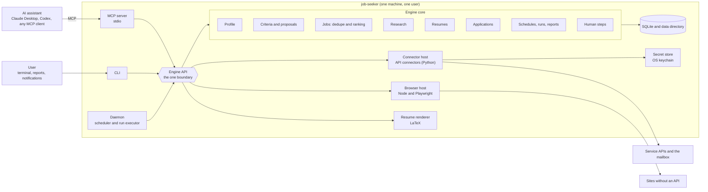
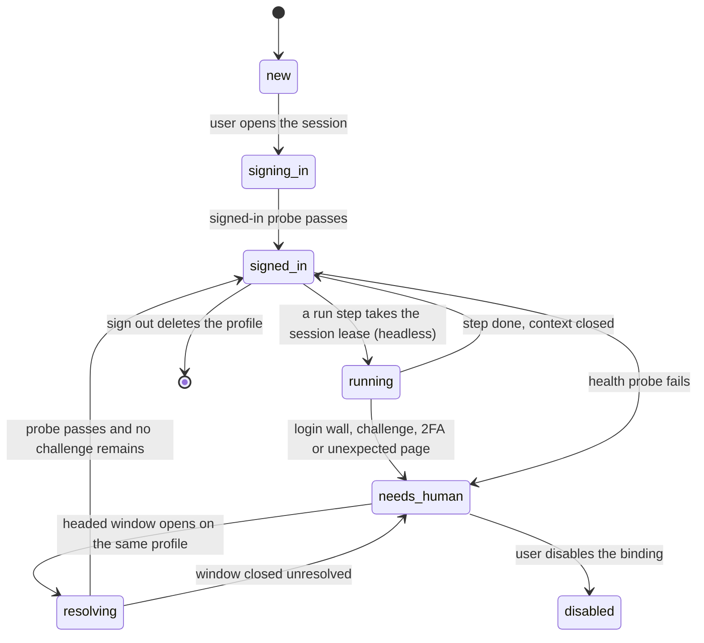

# job-seeker design

- **Status:** proposed, for review. Nothing in this document is built yet.
- **Companion:** [build-plan.md](build-plan.md) turns this design into phases.
- **Assumes:** the layout of the [migration pull request](https://github.com/merkensoft-iris/job-seeker/pull/6), which moves the predecessor `jobseek` code here with its history and makes its `jobseek/` folder this repository's root. Paths in section 11 use that layout.

## 1. Decisions at a glance

1. **One engine, local and single-user.** A Python engine core reuses the migrated `jobseek` code. State lives in one SQLite database plus a data directory outside the repository. There are no accounts, roles or sharing.
2. **One boundary.** Every caller goes through the **Engine API**: the MCP server, the CLI and the scheduler. It is a versioned set of JSON-schema'd commands, queries and events, and it is the surface cc-engine's extension API can wrap later. job-seeker never imports Command Center (CC) code.
3. **Connectors follow CC's connector model.** A connector is a package with a `connector.json` manifest that uses CC's fields. It declares capability contracts such as `jobs.search@1`. API connectors are Python modules. Browser connectors are JavaScript modules on a Node browser host built on Playwright.
4. **Browser sessions** use one persistent Chromium profile per service. They run headless by default and go headed only for a human step. A single **needs-human** signal is shown by the reports, the MCP server, the CLI and OS notifications.
5. **No AI inside job-seeker.** The engine and connectors make no model calls. The user's assistant does the judgement work through MCP, and job-seeker validates and persists the result. Scheduled runs work with no assistant.
6. **Ranking is rule-based first.** Rule scores rank every job unattended. Assistant scores are stored next to them when the user's assistant reviews matches.
7. **Nothing changes criteria without approval.** Research and the assistant only create proposals. The user approves in the CLI, or in the assistant through an MCP elicitation request, and every decision is recorded.

## 2. The design principle, per capability

The assistant does what needs judgement or writing. job-seeker keeps the durable state and does what needs a machine that is always on, logged in and exact.

| # | Capability | The assistant does | job-seeker provides and persists |
|---|---|---|---|
| 1 | Profile intake | Reads the extracted source text and proposes claims (skills with evidence, seniority, domains, achievements, locations, preferences). Discusses edits with the user | Text extraction from PDF, DOCX, LaTeX, free text and the LinkedIn profile. Stored sources. Versioned profile documents. Rejects a claim whose evidence quote does not match its source |
| 2 | API connectors | Nothing at run time | Connector registry, manifests, scoped HTTP, secrets, health |
| 3 | Browser connectors | Tells the user when a human step is waiting | Persistent profiles, headless runs, the human-step hand-off, pacing, challenge detection |
| 4 | Search by criteria | Optional judgement scores for top matches | Criteria sets, query mapping, dedupe, rule ranking, provenance |
| 5 | Market research | Weighs the findings and explains them to the user | Dated, evidence-backed aggregates over collected jobs and connector data |
| 6 | Criteria changes | Proposes changes and asks the user | Proposals, approvals, rejections and the audit record |
| 7 | Resumes | Selects and phrases claims for one job | Template registry, a grounding audit by claim ID, LaTeX render and checks, and resume records |
| 8 | Schedules and reports | Nothing (reports are readable without it) | Scheduler, runs, JSON and HTML reports |
| 9 | MCP server | Is the client | Tools, resources and workflow prompts |
| 10 | Research and criteria through the assistant | Runs research, proposes changes, gets the user's approval | The same proposal and approval path as the CLI |
| 11 | Applying | Fills in the employer's form and submits it, then reports back | The application packet (job details, apply URL, tailored resume) and the tracker states |

job-seeker has no chat UI, cover-letter writer, email writer or form filler. Workflows that used to be Claude Code commands become MCP prompts, which any MCP client can run.

## 3. Component map



**Processes.** There is no network listener. Processes share state only through the database and the data directory.

| Process | Started by | Role |
|---|---|---|
| `job-seeker daemon` | The per-user OS service (section 12.1) | The only scheduler. Executes runs, sends notifications, runs maintenance |
| `job-seeker mcp` | The assistant, over stdio | Serves MCP. It never schedules. It starts a run itself only when the daemon is not running |
| `job-seeker` (CLI) | The user | Setup, secrets, sessions, approvals, reports |
| Browser host | Spawned on demand by whichever process executes the run, over stdio JSON-RPC | Owns Playwright contexts. Closes after 10 idle minutes |

**Concurrency.** SQLite runs in WAL mode with short write transactions. A run is claimed with a lease row (owner, expiry, heartbeat), so the daemon and an MCP process never execute the same run. Each binding runs one step at a time. Each browser session is serial.

## 4. The engine boundary

- **Shape.** `jobseeker.core.Engine` exposes named operations. Each one has a kind (command or query), a risk (`read` or `write_internal`), and an input and output JSON Schema under `schemas/engine/v1/`. MCP tools, CLI commands and scheduler jobs are thin adapters generated from or checked against that table, so there is one source of truth.
- **Versioning.** `ENGINE_API = 1`. A breaking change adds `v2` schemas and keeps `v1` working for one minor release.
- **Events.** Every state change appends a domain event, such as `job.found`, `job.scored`, `criteria.changed`, `application.state_changed`, `human_step.opened` and `run.finished`. Events are stored in an `events` table with a monotonic cursor. Reports read from it, and a later integration can sync from it.
- **How CC can wrap it later (not built now):**
  1. Call the Engine API through job-seeker's MCP server, run as a local server with an allowlist of tools.
  2. Load job-seeker's connector manifests, which already use CC's fields. Browser connectors are JavaScript written against a CC-shaped context, so moving one is a re-host. API connectors are served through option 1 or ported.
  3. Consume `job.posting@1` records and the events feed as a "company" data source.

## 5. Data model

### 5.1 Where data lives

The data directory is `~/Library/Application Support/job-seeker` on macOS, `%LOCALAPPDATA%\job-seeker` on Windows and `$XDG_DATA_HOME/job-seeker` on Linux, or wherever `JOB_SEEKER_HOME` points. job-seeker refuses to start if the directory is inside a git work tree, so private data cannot be committed by accident.

```text
<data dir>/
  jobseeker.db                 # SQLite (WAL), schema version in PRAGMA user_version
  sources/<source_id>.<ext>    # profile source documents and their extracted text
  resumes/<resume_id>/         # resume.tex, resume.pdf, build.log
  reports/<yyyy>/<mm>/<run_id>.json|.html   # one report per run
  reports/latest.html, reports/dashboard.html
  browser/engine/              # the pinned Chromium build
  browser/profiles/<service>/  # one persistent profile per service, mode 0700
  browser/captures/            # page captures from failed parses (kept 14 days)
  backups/                     # database snapshot taken before each migration
  logs/                        # redacted, rotated
```

### 5.2 Entities

| Entity | Key fields | Notes |
|---|---|---|
| `profile_sources` | id, kind (`resume_pdf`, `resume_docx`, `resume_latex`, `resume_text`, `free_text`, `linkedin_profile`, `public_page`, `user_statement`), sha256, stored path, extracted text, imported_at | Immutable. Claims cite text spans in these |
| `profile_versions` | version, parent, document (`profile@1`), created_by (`user`, `assistant`, `import`), note, created_at | Immutable. The highest version is current. A revert saves an old document as a new version |
| `criteria_sets` / `criteria_versions` | set id, name, status; version, body (`criteria@1`), change_id | Every version comes from an approved change |
| `criteria_changes` | id, kind (`create`, `modify`, `archive`), target, proposed body or patch, proposed_by (`user`, `assistant`, `research:<run_id>`), evidence refs, status (`proposed`, `approved`, `rejected`, `superseded`), decided_by, decision channel (`cli`, `mcp_elicitation`, `assistant_reported`), decided_at, note | Append-only. Rejected proposals are kept |
| `jobs` | id, dedupe key, canonical URL, title, company, location, workplace, salary, seniority, description (guarded, untrusted), `partial`, first_seen, last_seen, status (`active`, `unreachable`, `expired`) | One row per real posting after dedupe |
| `job_sightings` | job id, connector, binding, external id, raw URL, run id, criteria set, record (`job.posting@1`), seen_at | Provenance: every source of every job |
| `job_features` | job id, skills, normalised title, certifications, salary figures | Small and kept after descriptions are pruned, so research evidence stays valid |
| `job_scores` | job id, profile version, criteria version, method (`rule`, `assistant`), score 0-100, band, gate verdicts, dimension scores, reason, scored_at | Both methods are kept. Section 8 says which one is shown |
| `research_runs` / `research_findings` / `research_notes` | run (profile version, window, inputs, created_at); finding (kind, subject, metrics, n, evidence refs); note (author, text, finding refs) | Dated, so findings can be compared over time |
| `templates` | id, name, LaTeX engine, path, sha256, page budget, licence | Synced from `templates/` in the repository |
| `resumes` | id, job id, template id and sha, profile version, content (items with claim IDs), audit result, PDF path, created_at | Each item traces to claims, and each claim to source spans |
| `applications` / `application_events` | job id, current state, resume id; event (from, to, at, reported_by, channel, note) | States: `found`, `shortlisted`, `resume_prepared`, `applied`, `interview`, `offer`, `rejected` |
| `schedules` | id, kind (`search`, `alerts`, `research`, `maintenance`), targets, schedule (interval, cron or manual), time zone, enabled, next_run_at | Survives restarts because it lives in the database |
| `runs` / `run_steps` | run (kind, trigger, status, lease, report id); step (connector, binding, criteria set, status, cursor, counts, redacted error) | Run statuses: `queued`, `running`, `waiting_for_human`, `succeeded`, `partial`, `failed`, `cancelled` |
| `connector_bindings` | id, connector id and version, settings, secret refs, health (`ok`, `degraded`, `needs_human`, `auth_expired`, `failing`, `disabled`) | One binding per connector and account |
| `browser_sessions` | service, profile dir, state, engine version, last probe, pacing | Section 7 |
| `human_steps` | id, binding or session, run step, reason, detail, URL to open, opened_at, notified_at, resolved_at, resolution | **The one needs-human signal** (section 7.3) |
| `events` | cursor, type, entity, payload, at | Section 4 |

### 5.3 Documents and evidence

The profile, criteria, reports and records are JSON documents. Each carries its own `schema` tag (`profile@1`, `criteria@1`, `report@1`, `job.posting@1`) and has an upgrade function. A profile claim must cite evidence:

```json
{
  "schema": "profile@1",
  "claims": [
    {
      "id": "clm_skill_pricing",
      "type": "skill",
      "value": "B2B pricing strategy",
      "evidence": [
        { "source_id": "src_resume_2026_11", "start": 1180, "end": 1251,
          "quote": "Led the pricing redesign for a B2B analytics product across 3 regions" }
      ]
    }
  ]
}
```

job-seeker rejects a version whose quotes do not match their source spans (whitespace is normalised). A fact the user states in conversation is first recorded as a `user_statement` source, and claims then cite it. The example person, product and figures are fictional.

### 5.4 Schema versions and migrations

1. `PRAGMA user_version` holds the schema version. Migrations are forward-only files, `store/migrations/NNNN_<name>.sql` or `.py` for data moves, and each runs in a transaction.
2. Before migrating, job-seeker writes `VACUUM INTO backups/jobseeker-v<N>-<timestamp>.db`. It refuses to open a database newer than it understands and asks the user to upgrade.
3. Tests migrate an empty database to the latest version, and every stored fixture snapshot (one per released schema version) to the latest.
4. `job-seeker import-legacy` reads the predecessor's `state/seen_jobs.json`, `state/last_run.json` and `tracker.csv` once, and records what it imported.

### 5.5 Secrets

- **Storage.** API keys and OAuth tokens go in the OS keychain through the `keyring` package (macOS Keychain, Windows Credential Manager, the Linux Secret Service). Where no keychain backend exists, they go in an encrypted file whose key file sits outside the data directory with mode 0600. That fallback protects against accidental copies and backups, not against someone using the same OS account, and setup says so.
- **Entry.** Secrets are entered only through the CLI (`job-seeker secrets set`, or `job-seeker connect gmail`, which runs the OAuth loopback flow in the system browser). They never pass through MCP, so the model never sees them.
- **Browser cookies** stay in the browser profile. Chromium encrypts them with the OS keychain where one exists (section 12.3).
- **Redaction.** Logs and reports pass through a redactor that masks every stored secret value. Cookie and authorization headers are never logged.

## 6. Connector contract

### 6.1 Kinds

| | API connector | Browser connector |
|---|---|---|
| Talks to | A service API over HTTPS, or the mailbox through the `mailbox@1` contract | A site in a signed-in, persistent browser profile |
| Code | Python module with `ctx.http` and `ctx.mailbox` | JavaScript module with `ctx.browser`, a guarded Playwright page |
| Sign-in | `api_key`, `oauth2` or `none` | `browser_session` |
| Hosted by | The connector host, in the engine process | The browser host, a Node child process |

### 6.2 Manifest

A connector's `connector.json` uses CC's manifest fields: `manifestVersion`, `id`, `name`, `version`, `kind`, `description`, `implements`, `auth`, `permissions`, `actions` (each with a risk class, schemas, idempotency and an optional rate limit), `syncs`, `records`, `settingsSchema`, `browser` (service, origins, login URL, signed-in probe, challenge signatures, `requiresHeaded`, pacing, `selectorsVersion`), `limits` and `flags` (`tos_risk`, `unofficial_surface`, `beta`). job-seeker's additions all sit under one key, `x-jobseeker`, so a CC port can move or drop them:

- `requires`: contracts the connector consumes, such as `mailbox@1`;
- `mail.senders`: the only senders an alert connector may read;
- `noFetchHosts`: portal hosts whose postings must never be fetched, because their terms forbid it;
- `market`: for example `us` or `in`.

```json
{
  "manifestVersion": 1,
  "id": "adzuna",
  "name": "Adzuna job search API",
  "version": "0.1.0",
  "kind": "api",
  "description": "Searches Adzuna's official API with a saved criteria set.",
  "implements": ["jobs.search@1", "market.stats@1"],
  "auth": { "method": "api_key", "inject": { "in": "query", "name": "app_key" },
            "instructions": "Register a free developer account, then run: job-seeker secrets set adzuna.app_key" },
  "permissions": { "network": { "hosts": ["api.adzuna.com"] },
                   "records": { "write": ["job.posting@1", "market.stat@1"] },
                   "secrets": { "custom": false } },
  "actions": [
    { "name": "search_jobs", "title": "Search jobs", "risk": "read", "idempotent": true,
      "confirmation": "policy", "rateLimit": { "perMinute": 20 },
      "inputSchema": { "$ref": "contracts/jobs.search@1#/input" },
      "outputSchema": { "$ref": "contracts/jobs.search@1#/output" } }
  ],
  "syncs": [],
  "records": ["job.posting@1", "market.stat@1"],
  "settingsSchema": { "type": "object", "required": ["app_id", "country"],
                      "properties": { "app_id": { "type": "string" }, "country": { "type": "string" } } },
  "limits": { "timeoutSeconds": 60, "maxMemoryMb": 256, "minSyncIntervalMinutes": 60 },
  "flags": [],
  "x-jobseeker": { "market": "us" }
}
```

### 6.3 Capability contracts

The engine calls contracts, never a specific connector.

| Contract | Members | Record | Used by |
|---|---|---|---|
| `jobs.search@1` | action `search_jobs({criteria, filters}) -> {records, unsupported, next}` | `job.posting@1` | Search runs (capability 4) |
| `jobs.alerts@1` | sync `alerts(cursor)` | `job.posting@1` | Alert ingest |
| `jobs.detail@1` | action `get_job({url or externalId})` | `job.posting@1` with its description | Detail fetch for top candidates |
| `profile.read@1` | action `read_own_profile()` | `profile.source@1` | Profile intake (capability 1) |
| `market.stats@1` | action `market_stats({query, kind})` | `market.stat@1` | Research (capability 5) |
| `mailbox@1` | actions `list_messages({senders, since})` and `get_message(id)`, read-only | `mail.message@1` | Alert connectors, through `ctx.mailbox` |

- **Records.** `job.posting@1` keeps CC's core fields (title, company, location, URL, source, posted time, and a description marked untrusted). It adds `workplace`, `salary {min, max, currency, period, predicted}`, `seniority`, `employment_type`, `apply_url`, `partial` and `employer_hidden`.
- **Criteria.** `search_jobs` receives the normalised criteria fields plus that connector's own `filters`, validated against the action's `inputSchema`. It returns the criteria fields it could not apply as `unsupported`, and the engine applies those after the search. Alert connectors take no query, because the user sets up alerts on the portal. Criteria sets filter and rank their results instead.

### 6.4 Runtime API

```python
class ConnectorContext(Protocol):
    run: RunInfo                  # run id, connector, version, binding, action or sync, deadline
    settings: Mapping[str, Any]   # validated against settingsSchema
    http: ScopedHttp              # HTTPS only, hosts from permissions.network.hosts, auth injected by the host
    mailbox: Mailbox | None       # only with x-jobseeker.requires mailbox@1; read-only, limited to mail.senders
    state: KeyValue               # per-binding cursor store, at most 64 KB
    clock: Clock                  # injectable, for deterministic tests
    def emit(self, record: Record) -> None: ...                 # validated against the record schema
    def log(self, level: str, msg: str, **fields) -> None: ...  # redacted by the host
    def needs_human(self, reason: str, detail: str) -> NoReturn: ...
```

Browser connectors get the same context in JavaScript, with `ctx.browser.page()` in place of `ctx.http`.

`needs_human` reasons are `signed_out`, `challenge`, `two_factor`, `consent_screen`, `unexpected_page` and `auth_expired`. These match CC's set.

### 6.5 Rules

1. **No AI.** Connectors make no model calls and no judgement calls. A static check fails any connector that imports an AI SDK or names an AI provider host.
2. **Determinism.** The same fixture input, settings, cursor and clock give byte-identical output and records.
3. **Credentials stay with the host.** A connector never receives a raw secret. The host injects authentication into requests.
4. **Untrusted text.** Text from services passes `posting_guard` at ingest. MCP returns it wrapped as `{"untrusted_page_content": ...}`.
5. **Site rules.**
   - Postings are fetched only through the `web-posting` connector, which enforces robots.txt and skips every `noFetchHosts` entry.
   - API hosts follow their API terms and are not robots-gated.
   - Rate limits and pacing come from the manifest, and a binding may only tighten them.
6. **The testing kit.** `job-seeker connector test <id>` runs offline and checks:
   - the manifest against its schema;
   - the static checks;
   - fixture tests for every action and sync;
   - determinism;
   - that a login-page fixture leads to `needs_human`;
   - fixture hygiene: no real names, emails, phone numbers, tokens or cookies.

### 6.6 Registry: adding a source

Each connector lives in `connectors/<id>/` with `connector.json`, its code (`connector.py`, or `index.js` and `extractors.js`), `fixtures/`, `tests/` and a `README.md` that says what it does and what it never does. The registry is `connectors/registry.json`: one entry per connector with id, version and enabled flag. **Adding a source means adding one directory and one registry line.** A test fails if a directory is unregistered, or if a registry entry has no directory.

### 6.7 The initial connectors

| id | Kind | Implements | Origin |
|---|---|---|---|
| `gmail` | api (oauth2, read-only scope) | `mailbox@1` | `tools/gmail_alerts.py` |
| `linkedin-alerts`, `indeed-alerts`, `ladders-alerts`, `employer-alerts` | api (mailbox) | `jobs.alerts@1` | `gmail_alerts.py` link extraction, `sources/registry.py`, `alert-sources.json` |
| `web-posting` | api (robots-gated GET) | `jobs.detail@1` | `tools/fetch_page.py`, `robots_check.py`, `page_decode.py` |
| `linkedin` | browser | `jobs.search@1`, `jobs.detail@1`, `jobs.alerts@1`, `profile.read@1` | the vendored LinkedIn app (section 7.4) |
| `adzuna` | api (api_key) | `jobs.search@1`, `market.stats@1` | Adzuna API portal issue |
| `naukri-alerts`, `iimjobs-alerts`, `execthread-alerts`, `builtin-alerts` | api (mailbox) | `jobs.alerts@1` | The four alert-email portal issues. Each portal's host goes in `noFetchHosts` |
| `github-public` | api (none) | none: an action that reads public repositories, used by `profile_expand_scan` | `expand/tools/github_source.py` |

WhatsApp and other browser services are not planned. The session model supports them if a job-search use appears.

## 7. Browser-session lifecycle

### 7.1 Mechanism

- **Profiles.** One Playwright persistent context per service (`launchPersistentContext(profileDir)`). Each service has its own profile directory, so sessions share no cookies or storage.
- **One build for both modes.** Headless runs and headed windows use the same full Chromium build (Playwright's `chromium` channel, so headless uses Chromium's new headless mode in that build) on the **same profile directory**.
- **One process per profile.** Chromium locks a profile to one process. Switching modes therefore closes one context cleanly, which flushes cookies, and launches the other.

### 7.2 States



1. **Sign in.** `job-seeker sessions open linkedin`, or the MCP tool `session_open`, creates the profile and opens a headed window at the manifest's `loginUrl`. The user signs in by hand. The host checks the read-only `probeSignedIn` every few seconds. When it passes, the session is `signed_in` and the window closes.
2. **Run headless.** A run step takes the session's lease, and the host launches the profile headless.
   - Every page load goes through the session's pacer: one at a time, a random 3 to 7 second gap and at most 40 loads an hour by default. A cap hit fails fast with a retry time, and the rest of the step is deferred to the next run.
   - After each navigation, the host checks the manifest's challenge signatures, common CAPTCHA frames and login URLs.
3. **Human step.**
   - On a match, or when the connector calls `ctx.needs_human`, the host records the URL and closes the headless context. It sets the session to `needs_human`, writes a `human_steps` row and marks the step `waiting_for_human`. The step keeps a cursor so it can resume.
   - **Interactive run** (started from MCP or the CLI): the same process reopens the profile headed at that URL straight away, and waits up to 10 minutes.
   - **Scheduled run:** the daemon sends a notification and the step waits. A binding setting can make the daemon open the window instead, when the user is active.
4. **Back to headless.** The user finishes the step in the headed window. Once the probe passes and no challenge signature remains, the host closes the window, sets the session to `signed_in` and resolves the human step. The waiting step then carries on headless in the same profile from its cursor.
5. **Time-out.** A scheduled step waits up to 12 hours, or until the same schedule's next run if that comes sooner. Then the step ends as `needs_human` and the run as `partial`. While the session stays `needs_human`, later runs skip that connector without loading a page and list it again under "Waiting for you". There is no retry loop against the site.
6. **Sign out** deletes the profile directory after the user confirms.

### 7.3 One needs-human signal

`human_steps` is the only record of "waiting for you", for browser sessions and for everything else that needs a person: an expired OAuth token, a keychain that denies access, or a connector whose selectors broke. Every surface reads that table:

- the report's "Waiting for you" section;
- the MCP `status` tool and the `jobseeker://human-steps` resource;
- `job-seeker status`;
- the OS notification.

### 7.4 Guards and the LinkedIn connector

The browser host applies these guards to every run:

- navigation pinned to the manifest's origins;
- no input into password, OTP or 2FA fields;
- no cookie or storage export to connector code;
- no downloads or permission grants unless the manifest declares them;
- **no evasion**: no changes to `navigator.webdriver`, the user agent or the fingerprint.

job-seeker never solves a CAPTCHA, types a credential or answers a security check.

The `linkedin` connector reuses the vendored app's extractors, URL builders, pacing defaults, result cache, failed-parse captures and the "LinkedIn needs you" detection. The app's Electron window and socket endpoint are replaced by the browser host.

| Need | Action | Notes |
|---|---|---|
| Job search with saved criteria | `search_jobs` | Criteria map to LinkedIn's keyword box and its experience-level, workplace, date-posted and job-type filters. Pagination stops at the limit |
| Job details | `get_job` | Fetched only for the top candidates of a run, within the hourly budget |
| The person's own profile | `read_own_profile` | New extractor. Stored as a `linkedin_profile` source for intake |
| Job-alert results | `alerts` sync | Lists the account's alerts, then replays each alert's search. LinkedIn's alert emails remain a second route through `linkedin-alerts`, which needs no session |
| People search | `search_people` | Read-only. Exposed only through `connector_call` |
| Save job | `save_job` | The app's only write. Not exposed |

The binding is created only after the user accepts its `tos_risk` flag. Section 9 of the build plan covers the LinkedIn risks.

## 8. Search, dedupe and ranking

1. **Collect.** Search steps run `jobs.search@1` for each selected connector and criteria set. Alert steps run `jobs.alerts@1`. Every record is stored as a `job_sightings` row.
2. **Dedupe.** The reused `url_canon` and `job_key` code merges sightings into `jobs` by canonical URL, then by company and title. A job keeps every source.
3. **Guard and detail.** Descriptions pass `posting_guard`. For the top candidates by rule score, `jobs.detail@1` fills in descriptions. A job with no fetchable detail is scored from what its alert says and flagged `partial`.
4. **Rule score, always.** Gates come first, and any gate failure vetoes the job:
   - exclusions;
   - seniority, comparing title signals with the criteria;
   - location and workplace;
   - a salary floor, applied when the salary is known.

   Weighted dimensions follow (title, skills against profile evidence, domain, seniority and location), with weights per criteria set. This reuses `rank_state`'s gates, bands and unreachable-retry rules.
5. **Assistant score, optional.** The MCP prompt `review_matches` asks the assistant to score the top matches on the rubric dimensions. `rank_submit` validates the scores and applies weights and vetoes through `rank_state`'s apply path. Both scores are kept.
6. **What is shown.** The assistant score is shown when it was made for the current profile version and the job has not changed since. Otherwise the rule score is shown. Every list labels which one it is.

## 9. MCP surface

Each tool is an adapter over one Engine API operation. Tool descriptions tell the assistant when to ask the user first.

| Capability | Tools | Resources and prompts |
|---|---|---|
| 1 Profile | `profile_import_source` (file path, or pasted text from an attachment), `profile_read_linkedin`, `profile_get`, `profile_save_version`, `profile_add_statement`, `profile_diff`, `profile_expand_scan` | `jobseeker://profile/current`, `jobseeker://profile/versions/{n}`, `jobseeker://profile/sources/{id}`; prompt `intake_profile` |
| 2, 3 Connectors and sessions | `connectors_list`, `connector_configure` (no secrets), `connector_call` (read-risk actions the manifest exposes), `sessions_list`, `session_open`, `session_done`, `human_steps_list` | `jobseeker://connectors`, `jobseeker://human-steps` |
| 4 Search | `criteria_list`, `criteria_get`, `search_run` (saved sets or one unsaved criteria body), `alerts_ingest`, `run_status`, `jobs_list`, `job_get`, `jobs_search`, `rank_submit` | `jobseeker://criteria/{id}`, `jobseeker://jobs/{id}`; prompt `review_matches` |
| 5, 10 Research | `research_run`, `research_get`, `research_list`, `research_compare`, `research_annotate` | `jobseeker://research/latest`; prompt `review_research` |
| 6, 10 Criteria changes | `criteria_propose`, `criteria_proposals_list`, `criteria_decide` | prompt `review_research` ends in a proposal |
| 7 Resumes | `templates_list`, `resume_prepare`, `resume_render`, `resume_get`, `resumes_list` | `jobseeker://templates`; prompt `tailor_resume` |
| 8 Schedules and reports | `schedules_list`, `schedule_set`, `schedule_delete`, `reports_list`, `report_get`, `dashboard_build` | `jobseeker://reports/latest`, `jobseeker://reports/{id}` |
| 11 Applications | `application_prepare` (job details, apply URL, resume PDF path), `application_set_state`, `applications_list`, `application_get` | prompt `apply_to_job` |
| All | `status`: daemon state, next runs, waiting human steps, pending proposals, failing connectors | |

**Approval through the assistant (capability 10).**

1. `criteria_decide` first asks the user directly with an MCP elicitation request, if the client supports one. The decision is then recorded with channel `mcp_elicitation`.
2. Without elicitation, the tool needs `user_confirmed: true` and the user's own words, and records channel `assistant_reported`.
3. The CLI records channel `cli`.

All three channels write the same `criteria_changes` record.

**The whole flow from Claude Desktop.** `profile_import_source`, then `profile_save_version`, `research_run`, `criteria_propose`, `criteria_decide`, `search_run`, `schedule_set`, `resume_prepare`, `resume_render`, `application_prepare` and `application_set_state`.

**Compatibility.** The existing server's tool names are kept as aliases until phase 2 ends (section 11). The stdio server stays standard-library only. It gains resources, prompts and elicitation, and negotiates the protocol version that supports them.

## 10. Scheduler and reports

### 10.1 Scheduler

- **Schedules.**
  - Kinds: `{kind: interval, minutes}`, `{kind: cron, expr, timeZone}` (five-field) and `{kind: manual}`. Time zones come from `zoneinfo`; Windows needs the `tzdata` package.
  - A schedule can never fire more often than any target connector's `minSyncIntervalMinutes`.
- **Defaults created by `job-seeker init`:**
  - alert ingest every 4 hours;
  - saved-criteria search daily at 07:00;
  - research weekly on Monday;
  - maintenance weekly.
- **Firing.**
  - The daemon checks due schedules every 30 seconds and adds plus or minus 10 percent jitter.
  - After sleep or downtime it runs a missed schedule once, not once per missed slot.
  - Each schedule has at most one active run.
- **Runs.** A run is a list of steps, one per connector, binding and criteria set. The steps run independently: a LinkedIn human step does not hold up Adzuna.
- **Retries.** Retries apply only to idempotent actions, after network errors, HTTP 429 or 5xx, with backoff at 1, 5 and 25 minutes. A binding that fails 3 runs in a row becomes `failing` and opens a human step.

### 10.2 Report format

Every run writes `reports/<yyyy>/<mm>/<run_id>.json` (`report@1`) and a matching `.html` page. The HTML is self-contained, works offline and escapes all untrusted text. Each run also refreshes `reports/latest.html` and the dashboard. `job-seeker report open` opens the latest report without any assistant.

```json
{
  "schema": "report@1",
  "run": { "id": "run_01JD3Q", "kind": "search", "trigger": "schedule", "schedule_id": "sch_daily_search",
           "started_at": "2026-12-01T07:00:04Z", "finished_at": "2026-12-01T07:09:41Z", "status": "partial" },
  "profile_version": 7,
  "criteria": [ { "id": "crs_product_remote", "name": "Product leadership, remote", "version": 3 } ],
  "summary": { "new_jobs": 12, "merged_duplicates": 9, "connectors_failed": 0, "waiting_for_you": 1, "pending_approvals": 2 },
  "new_jobs": [ { "job_id": "job_8f2c", "title": "Director of Product", "company": "Acme Analytics (fictional)",
                  "sources": ["adzuna", "linkedin-alerts"], "score": 78, "score_method": "rule" } ],
  "top_matches": [ { "job_id": "job_8f2c", "score": 78, "score_method": "rule", "band": "Strong Fit",
                     "flags": ["seniority:FLAG"], "sources": ["adzuna", "linkedin-alerts"], "partial": false } ],
  "changes_since_last_run": { "previous_run_id": "run_01JCZ1", "new": 12, "rescored": 3, "expired": 4,
                              "application_changes": [], "criteria_changes": ["chg_0042 approved"] },
  "connectors": [ { "connector": "adzuna", "status": "ok", "records": 31 },
                  { "connector": "linkedin", "status": "needs_human", "records": 0, "detail": "challenge" } ],
  "waiting_for_you": [ { "human_step_id": "hs_0007", "service": "linkedin", "reason": "challenge",
                         "since": "2026-12-01T07:03:12Z", "how": "job-seeker sessions open linkedin" } ],
  "pending_approvals": [ { "proposal_id": "chg_0043", "summary": "Add the title 'Group Product Manager'", "proposed_by": "research:res_0011" } ]
}
```

"Changes since the last run" compares with the previous finished run of the same schedule, or for an on-demand run, the previous run of the same kind and criteria sets.

## 11. How the existing code maps onto the new structure

Paths are relative to the repository root after the migration. **Keep** means move with little or no change. **Reshape** means keep the logic behind a new interface. **Retire** means remove, for the reason given.

| Existing | Verdict | Becomes |
|---|---|---|
| `tools/job_key.py`, `tools/url_canon.py` | Keep | `core/dedupe`: job identity and URL canonicalisation |
| `tools/alert_state.py` | Reshape | `core/jobs` ingest: candidate selection and store, on SQLite instead of `seen_jobs.json` |
| `tools/rank_state.py` | Reshape | `core/ranking`: gates, weights, bands, sweep, unreachable-retry, and the assistant-score apply path |
| `tools/config.py`, `config.example.json` | Reshape | Settings and connector bindings. `state_lock` gives way to transactions and run leases |
| `sources/registry.py`, `alert-sources.json` | Reshape | `connectors/registry.json`. Senders and host patterns move into each alert connector's manifest |
| `tools/gmail_alerts.py` | Reshape | The `gmail` connector (`mailbox@1`) and the four existing alert connectors |
| `tools/fetch_page.py`, `robots_check.py`, `page_decode.py` | Keep | The `web-posting` connector |
| `tools/posting_guard.py` and its copy in `tailor/tools/` | Keep one | `core/guard`. The copy is removed |
| `tools/notion_client.py`, `notion_sync.py`, `NOTION_SETUP.md` | Retire | The assistant's own Notion connector can read the tracker through MCP. That is the principle's "put it in the assistant" |
| `tools/upskill_state.py`, `upskill/upskill.md`, `upskill/README.md` | Reshape | Research `skill_gap` findings and the heatmap section of the research report. The learning-plan prose moves to the assistant's `review_research` prompt |
| `expand/tools/*`, `expand/expand.md` | Reshape | `profile_expand_scan` stores public pages as profile sources, and the `github-public` connector. The command becomes part of the `intake_profile` prompt |
| `tailor/tools/grounding_audit.py`, `ats_keywords.py` | Keep | `resume/` audit, now checking each item against the claims it cites, and keyword coverage for `resume_prepare` |
| `tailor/tools/render_latex.py`, `compile_latex.py`, `verify_pdf.py`, `verify_layout.py`, `latex_pipeline.py` | Keep | `resume/` render, compile and verify loop |
| `tailor/tools/latex_templates/resume.tex.tmpl` | Reshape | The first template in `templates/` |
| `tailor/tools/latex_templates/cover.*`, the why-me note | Retire | Cover-style writing belongs to the assistant |
| `tailor/tools/export_resume.py` (pandoc and .docx route) | Retire | LaTeX is the single output route. Revisit if an employer requires .docx |
| `tailor/tailor.md`, `tailor/agents/resume-reviewer.md` | Reshape | MCP prompt `tailor_resume`, which includes the reviewer's checks |
| `linkedin/app/src/extractors.js`, `urls.js`, `pacing.js`, `cache.js`, `format.js`, `capture.js` and their tests | Keep | The `linkedin` connector and the browser host's pacer |
| `linkedin/app/src/main.js`, `server.js`, `paths.js`, `bin/linkedin-mcp.js` | Retire | Replaced by the browser host's persistent contexts and stdio link. The "needs you" logic moves across |
| `linkedin/client.py`, `linkedin/source.py` | Reshape | The engine's browser-host client, and the connector's criteria-driven search |
| `mcp/server.py` | Keep | Gains resources, prompts and elicitation |
| `mcp/tools.py` | Reshape | Thin adapters over the Engine API. Old names (`run_alerts`, `rank`, `list_shortlist`, `get_posting`, `search_seen`, `linkedin_search`, `get_job`, `search_people`, `tailor`, `upskill_report`, `expand_profile`, `dashboard`) stay as aliases until phase 2 ends |
| `dashboard/build.py` | Reshape | `reports/`: the dashboard and the per-run report pages |
| `profile/candidate-profile.example.md`, and the user's gitignored filled copy `profile/candidate-profile.md` | Reshape | The template becomes intake guidance. The filled copy is an import source for the first profile version |
| `profile/job-evaluation.example.md` and its gitignored filled copy | Reshape | The rule ranker's gates and weights per criteria set, plus the `review_matches` prompt |
| `profile/writing-style.example.md` and its gitignored filled copy | Reshape | The profile's `preferences.writing`, passed to the assistant by `resume_prepare` |
| `tracker.schema.csv`, `state/`, `applications/` | Reshape | The `applications` tables, plus CSV export and the one-time legacy import |
| `tests/` and each module's fixtures | Keep | Move next to their modules. Fixtures stay fictional |
| `.github/workflows/jobseek-tests.yml` | Reshape | CI on Linux, macOS and Windows |
| `NOTICE` | Keep | MIT attribution for the derived files |
| `CLAUDE.md` trust rules | Keep | Engine invariants, and the rules in section 6.5 |
| `.claude/commands/run-alerts.md`, `.claude/commands/notion-sync.md`, `.claude/agents/posting-scorer.md` | Retire | Replaced by scheduled runs, `search_run`, `web-posting` and the `review_matches` prompt, which carries the posting scorer's gates and rubric |
| The README's "Current code (migrated from jobseek)" section | Reshape | Replaced phase by phase with the new engine's install and usage notes |

## 12. Open questions, answered

### 12.1 Background running

**Recommendation:** a per-user lightweight daemon (`job-seeker daemon`), installed as a per-user OS service by `job-seeker service install`:

- a launchd LaunchAgent on macOS;
- a systemd user unit on Linux;
- a Task Scheduler task that starts at log-on on Windows.

**Why.**

- It runs in the user's session, which is what opening a headed browser window and reading the user's keychain need. A system-wide service can do neither.
- A plain login item cannot restart after a crash.
- An app with its own UI would duplicate what reports and the assistant already provide.

**When no assistant is connected,** a "waiting for you" step reaches the user through an OS notification and the report's "Waiting for you" section. `job-seeker status` lists it, and `job-seeker sessions open <service>` opens the headed window on that profile. If the daemon is not installed, `status` says so, and runs started from MCP or the CLI still execute in-process.

### 12.2 Notifications

**Recommendation:**

- **Report entry, always.** It is the durable record.
- **OS notification for events that need action:** a human step, criteria proposals waiting for a decision, and a connector that has started failing. Optionally, one daily digest of new top matches.
- **No email in v1.** Sending email would need either Gmail's send scope, which breaks the read-only Gmail rule, or a new SMTP secret.

Notifications use `osascript` on macOS, `notify-send` on Linux and a PowerShell toast on Windows. Each notification names the command to run, because click actions differ between platforms. If notifications are unavailable, the report entry and `status` still show everything.

### 12.3 Browser engine

**Recommendation:** Playwright persistent contexts on the full Chromium build, one profile directory per service, with the same build and the same profile for headless and headed runs (section 7.1).

**Why.**

- One build in both modes keeps the browser identical between the user's sign-in and later headless runs, which gives the most durable sessions.
- Persistent contexts are documented Playwright API.
- The existing extractor pattern ports directly.
- It matches the browser model of CC's connector design, so connectors stay portable.

The existing Electron app could hide its window instead of running headless. But a hidden window still needs a display, and the app would have to be duplicated for every service.

**Durability details.**

- **Cookie encryption.** Ask Chromium to encrypt cookies with the OS keychain where one exists. Playwright's default launch flags select a mock keychain on macOS and a basic password store on Linux. The phase 3 spike verifies this and records the flags used.
- **Clean shutdown.** Always close contexts cleanly, so cookies reach the disk.
- **After an upgrade.** Re-probe every session after a Playwright or Chromium upgrade.
- **Sites that refuse headless.** Let a site's manifest set `requiresHeaded`, which runs it in a headed window instead. Never mask automation.

### 12.4 Ranking

**Recommendation: a mix with a fixed split** (section 8).

- **Rule-based ranking always runs.** It covers the gates and the weighted dimensions, so unattended runs and reports rank on their own.
- **The user's assistant adds judgement scores** through the `review_matches` prompt and `rank_submit`.
- **No API key in v1.** job-seeker does not call an LLM with a key of its own.

**Why.** The principle puts judgement in the assistant. Scheduled runs must work with no assistant. A built-in model call would add a secret, a cost and a second AI path, against "no AI inside job-seeker". The scorer interface leaves room for an optional key-based scorer later, if unattended judgement proves necessary.

### 12.5 Data growth

**Recommendation.**

| Data | Kept | Limit |
|---|---|---|
| Job identity (dedupe key, URL, title, company, scores, sources) and `job_features` | For the life of the installation, so old postings never come back as new | Small: about 1 KB per job |
| Full descriptions and raw records | 180 days, then pruned. Jobs linked to an application, resume or research evidence keep theirs | |
| Run reports | 180 days, and the last 50 always | |
| Resumes, profile versions, criteria changes, research runs | Kept until the user deletes them | |
| Page captures | 14 days | 200 MB |
| Browser profiles | Indefinitely. Weekly maintenance clears Chromium's caches (HTTP cache, code cache, GPU cache, service-worker cache) but never cookies or site storage | Warn at 1 GB per profile |
| Whole data directory | | Warn at 2 GB. `job-seeker gc` prunes on demand, and the weekly maintenance run prunes and vacuums |

**Why.** Dedupe needs a permanent identity, which is cheap. Bulk text is what grows. At 50 jobs a day, descriptions add about 0.5 MB a day, so 180 days stays under 100 MB. Clearing only caches keeps sign-ins intact.

## 13. Further decisions for review

Each item is a recommendation in this design. A reviewer can overturn it without changing the rest:

1. Retire Notion sync (section 11).
2. Retire the pandoc and .docx resume route.
3. Retire the why-me note.
4. Keep LinkedIn people search, but only through `connector_call`.
5. Add Node as a dependency for browser connectors only, alongside Python. Keep Python standard-library first, adding only `keyring` and, on Windows, `tzdata`.

## 14. Non-goals

- Multi-user features of any kind.
- A chat UI, cover letters, email writing, or filling in application forms.
- Solving or bypassing CAPTCHAs and security checks, or masking automation.
- The Command Center integration itself. Section 4 only keeps it possible.
