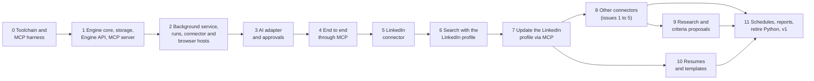

# job-seeker execution plan

- **Status:** the plan for the build. It supersedes the earlier build plan.
- **Design:** [design.md](design.md). Section numbers such as "design 7.5" point there.
- **Shape:** MCP first. The basic components are built and then proven end to end **through the MCP interface** before any real connector. LinkedIn is the first connector. Then the user searches for jobs with their LinkedIn profile, then updates that profile, all from their assistant over MCP. Everything else follows.

## 1. Overview

| Phase | Delivers | MCP acceptance (in CI, fictional data) | Real-account manual check | Release |
|---|---|---|---|---|
| 0 | TypeScript toolchain, CI, MCP test harness, stub server | The harness connects and calls `status` | None | v0.0.1 |
| 1 | Engine core, storage, Engine API, MCP server, pipeline page, setup (first cut) | Jobs, ranking, applications and the pipeline page over imported legacy fixtures | MC-1.1 legacy import of the real state | v0.1.0 |
| 2 | Background service, runs, scheduler, connector host, browser host, sessions, human steps | A run goes through the service and through the in-process fallback; a browser human step pauses, opens a window and resumes headless | MC-2.1 LaunchAgent opens a window (demo site) | v0.2.0 |
| 3 | AI adapter, approvals, criteria | Adapter call sites and their checks; approval by chat, elicitation and CLI | MC-3.1 adapter on the user's own CLIs | v0.3.0 |
| 4 | End-to-end flow, client matrix, demo mode | One scripted session covering every basic component | MC-4.1 demo flow in Claude Desktop and Codex | v0.4.0 |
| 5 | `linkedin` connector, read side | Sign-in, search, details, own profile, alerts, budget, challenge hand-off | MC-5.1 to 5.5 on the main account | v0.5.0 |
| 6 | Profile intake from LinkedIn, criteria from the profile, search | Profile to claims to criteria to ranked LinkedIn jobs | MC-6.1, 6.2 | v0.6.0 |
| 7 | LinkedIn profile edits | Diff, grounding, approval, headed apply, verify; every refusal path | MC-7.1, 7.2 one reversible edit | v0.7.0 |
| 8 | Gmail and alert connectors, `web-posting`, issues 1 to 5, Notion, profile expansion | Alerts merged with LinkedIn sightings; each connector's kit | MC-8.x per connector | v0.8.0 |
| 9 | Research, synthesis, criteria proposals | Evidence-backed findings, proposals through approvals | MC-9.1 | v0.9.0 |
| 10 | Resumes, templates, Tectonic, .docx, "why me" note | Grounded resume in every template; fabricated items refused | MC-10.1 | v0.10.0 |
| 11 | Full reports, unattended match review, retention, Python retired | A simulated week runs unattended, then MCP reads it back | MC-11.1 one real week | v1.0.0 |

Phases 8 and 10 can be built side by side once phase 7 ships.

## 2. Rules for every phase

1. **Shippable.** Each phase ends with a tagged release that installs with `npm install -g` and, from phase 1, `job-seeker setup`, and runs on its own. Phase 0's stub server has no `setup` yet. Behaviour from earlier phases keeps working.
2. **Accepted through MCP.** A phase is done only when its MCP acceptance scenarios (`AT-<phase>.<n>`) pass in CI and its client check passes in Claude Desktop and Codex (section 3).
3. **Fictional data in CI; the real account only in named manual checks.**
   - Fixtures use fictional people and `example.com` or `.example.test` addresses. CI runs a fixture-hygiene scan and a secret scan.
   - A manual check that touches a real account is named `MC-<phase>.<n>`, lists its steps in `docs/checks/phase-<n>.md`, and refuses to run when `CI=true`. Its notes record outcomes only, never personal data.
   - The data directory is never inside the repository, and job-seeker enforces this.
4. **Port by spec.** A ported module's Vitest suite is a translation of its Python (or JavaScript) tests, with the same fixtures, before its code is written (section 4).
5. **Migrations.** Every schema change ships with a migration, a fixture database snapshot and a test that migrates it.
6. **Connectors.** Every connector passes `job-seeker connector test <id>` offline (design 6.5).
7. **Docs.** A phase that changes a design decision updates `design.md` in the same pull request. A spike or a choice made during a phase is written up in `docs/decisions/`.
8. **Public repository.** Commits use a GitHub noreply author. No real names, emails, account data or captures are committed.

## 3. The MCP acceptance harness

Built in phase 0 and used by every later phase.

- **Test client.** `test/mcp/harness.ts` uses the MCP TypeScript SDK's client to spawn `job-seeker mcp` over stdio, exactly as Claude Desktop and Codex do. It sets `JOB_SEEKER_HOME` to a fresh temporary directory.
- **Scenarios.** Each acceptance test is a scenario: a sequence of tool calls, resource reads and prompt fetches, with assertions on the structured results and on the database afterwards. Scenarios are named `AT-<phase>.<n>` and live in `test/mcp/scenarios/`.
- **Two client profiles.** The harness runs each scenario that involves an approval twice: once as a client that supports elicitation (it answers with a scripted reply) and once as a client that does not.
- **Fakes, never real services.**
  - A fake clock, injected into the engine, the service and the pacer.
  - The `fake` AI adapter backend, with canned outputs per scenario.
  - A fake notifier that writes notifications to a file the test reads.
  - Recorded HTTP replays for API connectors.
  - For browser connectors, Playwright request routing serves fictional fixture pages for the connector's real origins, so origin pinning is tested unchanged and nothing leaves the machine.
  - A scripted "human" that acts in the headed window during a human step (a test-only hook, absent from the published package).
- **Service in the loop.** Scenarios run the service as a child process (`job-seeker service --foreground`) and also with it stopped, so both the hand-off and the in-process fallback are covered.
- **Demo mode.** `job-seeker demo init` creates a separate data directory with fictional data and the fixture connectors, so a person can repeat a scenario by hand in a real client without touching a real account.
- **Client check.** At the end of each phase, the phase's scenario is repeated by hand in Claude Desktop and in Codex against demo mode, using plain requests. The checklist lives in `docs/checks/phase-<n>.md`. Client differences, such as elicitation support, are recorded in `docs/decisions/mcp-clients.md`.

## 4. Porting the Python to TypeScript

### 4.1 Method

1. **Spec first.** Translate the module's tests to Vitest with the same fixtures and assertions. Behaviour that changes by design (for example, JSON state files becoming SQLite tables) is rewritten as a new test that cites the design section.
2. **Port** until the translated suite passes.
3. **Parity.** For pure functions, `scripts/parity/` runs the Python and the TypeScript versions on the same fixture inputs and compares normalised JSON. It covers `url_canon`, `job_key`, `posting_guard`, `rank_state` scoring, `ats_keywords` and `grounding_audit`, and runs in CI while both versions exist.
4. **Retire** the Python module and its tests in the phase that replaces the workflow using it, not before.

### 4.2 The existing workflow during the port

The predecessor's `run alerts` workflow, its Python MCP server and its JSON state keep working until the phase that replaces each part. The user moves to the new engine one capability at a time:

| When | Still on the predecessor | Already on the new engine |
|---|---|---|
| Phase 4 ships | Everything | Nothing (demo data only) |
| Phase 5 ships | `run alerts` with both its LinkedIn and Gmail ingest, ranking, the top-5 shortlist, Notion, tailor, upskill, expand, and the Python MCP server with all its tools, including its three LinkedIn tools. The predecessor's LinkedIn ingest still runs through `linkedin/client.py`, `linkedin/source.py` and the Electron app, which therefore stays installed | The new LinkedIn MCP tools (search, details, own profile, alerts), side by side with the predecessor's. The predecessor's shortlist stays the single shortlist: it ranks LinkedIn and Gmail jobs together |
| Phase 8 ships | Tailor and upskill, on the Python MCP server trimmed to `tailor` and `upskill_report` | Profile, criteria, search, LinkedIn and Gmail alerts, ranking, the shortlist, applications, Notion. **Cutover:** `run alerts` (both halves), the posting-scorer agent, the Electron app, `linkedin/client.py`, `linkedin/source.py` and every other Python server tool are removed in the same release, and the new engine's shortlist becomes the single shortlist |
| Phase 9 ships | Tailor, on the Python MCP server trimmed to `tailor` | Research, replacing `upskill_report` |
| Phase 10 ships | Nothing. The Python MCP server is removed | Everything |

Phases 9 and 10 can ship in either order: the Python MCP server keeps whichever of `tailor` and `upskill_report` is not yet replaced, and it is removed with the second of the two. After the phase 8 cutover its tools read the predecessor's state as it stood at the cutover; for a job found later, the user runs `/tailor` with the URL from `job_get`.

From phase 5 to phase 8 the Electron app and the new connector use the same LinkedIn account with separate pacers, so the user keeps their combined page views under the daily cap of 200, by setting a lower cap on the new connector or running it by hand only.

`job-seeker import-legacy` can be run again until phase 8; it merges newly seen jobs and tracker rows and skips what it already imported.

### 4.3 Order

Test counts are the test functions in each suite today; parametrised cases add more.

| Existing code | Spec tests | Port in phase | Becomes | Python retired in phase |
|---|---|---|---|---|
| `tools/url_canon.py`, `tools/job_key.py` | `test_url_canon` (9), `test_job_key_audit` (2), key cases in `test_tools_integrity` | 1 | `core/dedupe` | 8 |
| `tools/posting_guard.py`, `tools/page_decode.py` (and the `tailor/tools/` copies) | guard cases in `test_tools_integrity`, `tailor/tests/test_posting_guard` (2) | 1 | `core/guard` | 8 (the `tailor/` copies in 10) |
| `tools/config.py` | `test_config` (17) | 1 | settings and bindings | with the Python MCP server (9 or 10), which still imports it |
| `tools/alert_state.py` | `test_alert_state` (11), `test_state_lock` (2) | 1 | `core/jobs` ingest, leases | 8 |
| `tools/rank_state.py` | `test_rank_state` (19) | 1 | `core/ranking` | with the Python MCP server (9 or 10), which still imports it |
| `dashboard/build.py` | `dashboard/tests` (9) | 1 | the pipeline page | 8 |
| `mcp/server.py` | `test_mcp_server` (11) | 0 and 1 | protocol error paths of the TypeScript server | trimmed in 8 and 9, removed once 9 and 10 have both shipped |
| `mcp/tools.py` | `test_mcp_tools` (38) | 1 to 10, per tool (section 4.4) | the new MCP tools | per tool: all but `tailor` and `upskill_report` in 8, `upskill_report` in 9, `tailor` in 10 |
| `linkedin/app/src/pacing.js`, `cache.js`, `capture.js` | `pacing`, `cache_format`, `capture` (19) | 2 | the browser host's pacer, cache and captures | 8 |
| `linkedin/app/src/extractors.js`, `urls.js`, `format.js`, `tools.js` | `extractors`, `tools`, `server` (28) | 5 | the `linkedin` connector | 8 |
| `linkedin/client.py`, `linkedin/source.py` | `test_linkedin_client` (15), `test_linkedin_source` (10) | 5 | criteria mapping in the connector | 8 |
| `expand/tools/read_source.py`, `profile_sources.py`, `linkedin_source.py`, `competency_map.py` | their `expand/tests` suites (27 plus the relevant `test_expand_run` cases) | 6 | profile sources and intake | 8 |
| `tailor/tools/grounding_audit.py` | `test_grounding_audit` (13) | 7 | `core/grounding`, shared by profile edits and resumes | 10 |
| `tools/gmail_alerts.py`, `sources/registry.py`, `alert-sources.json` | `test_gmail_alerts` (10), `test_source_registry` (8) | 8 | `gmail` and the four alert connectors | 8 |
| `tools/fetch_page.py`, `robots_check.py` | fetch and robots cases in `test_tools_integrity` | 8 | `web-posting` | 8 |
| `tools/notion_client.py`, `notion_sync.py` | `test_notion_client` (7), `test_notion_sync` (15) | 8 | the `notion` connector | 8 |
| `expand/tools/github_source.py`, `scholar_source.py`, `web_source.py`, `expand_profile.py` | the rest of `expand/tests` | 8 | `github-public` and `profile_expand_scan` | 8 |
| `tools/upskill_state.py`, `upskill/` | `test_upskill_state` (17), `test_upskill_command` (10) | 9 | research findings | 9, with the server's `upskill_report` |
| `tailor/tools/*` (render, compile, verify, pipeline, keywords, export) | the rest of `tailor/tests` (60) | 10 | `resume/` | 10 |

### 4.4 The predecessor's MCP tools

| Old tool | New tool | Phase |
|---|---|---|
| `rank`, `list_shortlist` | `jobs_list` (ranked, with a shortlist filter) | 1 |
| `get_posting` | `job_get` | 1 |
| `search_seen` | `jobs_search` | 1 |
| `dashboard` | `pipeline_page` | 1 |
| `linkedin_search` | `search_run` with an unsaved criteria body on `linkedin` | 5 (old tool retired in 8) |
| `get_job` | `job_get` with a detail fetch | 5 (old tool retired in 8) |
| `search_people` | `linkedin_search_people` (manual only) | 5 (old tool retired in 8) |
| `run_alerts` | `alerts_ingest` | 8 |
| `notion_sync` | `notion_sync` | 8 |
| `expand_profile` | `profile_expand_scan` | 8 |
| `upskill_report` | `research_run` | 9 (the trimmed Python server drops it) |
| `tailor` | `resume_prepare`, `resume_tailor`, `resume_render` | 10 (the trimmed Python server drops it) |

## 5. Phase 0: toolchain and MCP harness

**Goal.** A TypeScript package that builds, tests and answers one MCP call, with the harness every later phase uses.

**Scope.**

- `package.json` with the `job-seeker` command, `tsconfig.json` (`strict`), ESLint, Vitest, and Node.js 22 as the minimum.
- CI: a Node job on Linux, macOS and Windows, next to the existing Python job, plus the fixture-hygiene scan and a secret scan.
- `job-seeker mcp`: a stub stdio server with one tool, `status`, returning the version and `engine_api: 1`.
- The MCP harness and the first scenarios (section 3).
- `docs/decisions/` and `docs/checks/`, with their templates.

**MCP acceptance.**

- **AT-0.1** The harness spawns the server, completes the handshake and negotiates the protocol version. `tools/list` returns `status`, and calling it returns the version.
- **AT-0.2** An unknown tool, non-object arguments and an unknown argument each return an MCP error, not a crash. These port the error-path cases of `test_mcp_server` and `test_mcp_tools`.

**Client check.** Add the stub to Claude Desktop and to Codex by hand; ask each for job-seeker's status.

**Manual steps for the user.** Install Node.js 22 if it is missing.

## 6. Phase 1: engine core, storage, Engine API and MCP server

**Goal.** The engine keeps its state in SQLite, exposes the Engine API, and serves it over MCP. The user's assistant can list ranked jobs, read a job, track applications and open the pipeline page.

**Scope.**

- **Storage.**
  - Decide between `node:sqlite` and `better-sqlite3` by checking WAL, `VACUUM INTO`, and install on all three CI platforms; record it in `docs/decisions/storage-driver.md`.
  - The migration runner and the first migration with every table the basic components need (design 5.2): settings, events, profile sources and versions, criteria, approvals, jobs, sightings, features, scores, applications, runs, steps, schedules, human steps, bindings, browser sessions and `ai_calls`.
  - A backup before each migration, refusal of a newer database, and refusal of a data directory inside a git work tree.
- **Engine API v1.** The operation table, its JSON Schemas, the generated TypeScript types and the events feed.
- **Engine core** (ported, section 4.3): dedupe, the posting guard, ranking, jobs ingest, settings, applications and their states, and the profile core (sources, versions and quote validation for pasted text and user statements).
- **Secrets.** The keychain store, the encrypted-file fallback and the redactor; `job-seeker secrets set|list|delete`.
- **MCP server.** Generated from the operation table: `status`, `jobs_list`, `job_get`, `jobs_search`, `rank_submit`, `applications_list`, `application_get`, `application_set_state`, `profile_import_source` (text), `profile_get`, `profile_save_version`, `profile_add_statement`, `pipeline_page` and `human_steps_list`, with their resources. Untrusted text is wrapped (design 6.5).
- **Pipeline page.** The read-only page from the ported dashboard (design 10.3).
- **Legacy import.** `job-seeker import-legacy`, repeatable until phase 8.
- **Setup, first cut.** `job-seeker setup` creates the data directory and `config.json` and writes the MCP configuration for Claude Desktop and Codex, showing each change and keeping a backup. `setup --check` reports the state.

**MCP acceptance.**

- **AT-1.1** After importing the fictional legacy fixtures, `status` reports the counts. `jobs_list` returns jobs ranked by rule score, each naming its sources and score method; vetoed jobs are excluded and `top_n` is respected.
- **AT-1.2** `job_get` returns the description inside `untrusted_page_content`, and the prompt-injection fixture carries the guard's findings.
- **AT-1.3** `jobs_search` matches on title, company and location; an empty query is refused.
- **AT-1.4** `rank_submit` refuses out-of-range or malformed scores, stores valid ones as method `assistant`, and a gate veto still holds.
- **AT-1.5** `application_set_state` moves a job through `found`, `shortlisted` and `applied`, writing an event each time. `pipeline_page` returns a path; the page shows the states and escapes the injection fixture.
- **AT-1.6** `profile_import_source` stores pasted text; `profile_save_version` accepts a claim whose quote matches and refuses one whose quote does not, naming the claim.
- **AT-1.7** A database from a newer schema makes `status` return a clear "upgrade job-seeker" error.

**Client check.** `setup` configures both clients; in each, ask for the top jobs and for the pipeline page, over demo data.

**Real-account manual check.** **MC-1.1** Run `import-legacy` on the user's real predecessor state. The imported counts match `state/seen_jobs.json` and `tracker.csv`, and the pipeline page shows the user's applications. The data stays in the data directory.

**Manual steps for the user.** Run `setup`; allow it to edit the two clients' configuration files; restart Claude Desktop.

## 7. Phase 2: background service, runs, connector host and browser host

**Goal.** Work runs in the background in the user's session. A browser run that needs a person pauses, tells the user, opens a window, and carries on headless when the person is done.

**Scope.**

- **Runs.** Run and step records, leases, heartbeats, step cursors, the queue and the wake file, and the in-process fallback when the service's heartbeat is stale (design 3).
- **Service.** `job-seeker service` with the scheduler: interval, cron and manual schedules, jitter, one catch-up after sleep or log-out, one active run per schedule. `setup` installs, starts and checks the LaunchAgent; `job-seeker service install|uninstall|status`.
- **Notifications** through `osascript`, and the human-steps lifecycle (design 7.3).
- **Reports, basic.** `report@1` JSON and HTML for every run, and `latest.html`.
- **Connector host.** The manifest schema and its validation, the registry, the contracts' schemas, the connector context, scoped HTTP, and the connector kit (`job-seeker connector test`).
- **Browser host.** Playwright persistent contexts, the guards, the pacer (ported, with page loads counted in the database and a daily cap), the cache, captures, challenge detection, and headless-to-headed switching on one profile. Session states and `session_open`, `session_done` and `sessions_list`. `setup` downloads the browser with the user's consent.
- **Fixture connectors** for tests and demo mode only: `fixture-jobs` (API, recorded replies) and `fixture-site` (browser, with a login wall and a challenge page).
- **MCP tools.** `search_run` (on any registered connector, with an unsaved criteria body until phase 3 adds approvals), `run_status`, `schedules_list`, `schedule_set`, `schedule_delete`, `reports_list`, `report_get`, `connectors_list`, `connector_configure`, and the session tools.

**MCP acceptance.**

- **AT-2.1** With the service running, `search_run` on `fixture-jobs` returns a queued run; the service executes it; `run_status` reports success; `jobs_list` shows the jobs with their source; a report exists.
- **AT-2.2** With the service stopped, the same call runs in-process. When the service starts mid-run, the lease stops it from running the same run twice.
- **AT-2.3** A `fixture-site` search meets the challenge page. The run becomes `waiting_for_human`; `human_steps_list` shows the step; the fake notifier received one notification; a headed context was launched on the same profile directory. The scripted human clears the challenge; the probe passes; the run resumes headless from its cursor and succeeds. The guard log shows no input into credential fields.
- **AT-2.4** With the fake clock, the 201st page load of a day and the 41st of an hour are refused; the remaining work is deferred and `run_status` says so. The count is shared between the service and an in-process run.
- **AT-2.5** `schedule_set` creates an interval schedule; advancing the clock fires one run; a simulated sleep across three slots fires one catch-up run.
- **AT-2.6** The guards refuse input into a password field, block an off-origin navigation and refuse a cookie export.
- **AT-2.7** A step left waiting past its limit ends as `needs_human`; the run is `partial`; the next run skips the connector without loading a page.

**Client check.** In demo mode, ask Claude Desktop and Codex to run a search on the fixture site; the window opens, the user clears the demo challenge, and the assistant reports the results.

**Real-account manual check.** **MC-2.1** (no real site) On the user's Mac: `setup` installs the LaunchAgent; after a reboot the service is running; a demo schedule fires; a demo human step opens a visible window **from the service**, not from a terminal. This proves design 7.1's "where windows come from".

**Manual steps for the user.** Allow job-seeker under macOS's "Background items added" prompt; allow notifications; consent to the browser download.

**Risks.** A LaunchAgent that is not limited to the graphical session cannot open windows; MC-2.1 checks it on the real machine.

## 8. Phase 3: AI adapter and approvals

**Goal.** The five AI call sites exist behind one switchable adapter, each with its deterministic check. Criteria are created and changed only through approval records.

**Scope.**

- **AI adapter** (design 13): the `claude-code`, `codex`, `anthropic-api`, `off` and `fake` backends; `ai.uses.<name>` switches; per-run and per-day caps; `ai_calls` records; the untrusted block; the fallback paths. A lint rule and a test limit imports of the adapter to the five call sites. The exact command-line options that run each assistant CLI with no tools are recorded in `docs/decisions/ai-adapter-backends.md`.
- **Call sites wired in this phase:** `profile_intake` (`profile_intake_run`) and `match_review` (`match_review_run`). The other three are wired in phases 9 and 10 against the same interface.
- **Approvals** (design 9.1): the record, hash binding, expiry, supersession, the three channels, `approvals_list`, `approval_get`, `approval_decide`, and `job-seeker approvals list|show|approve|reject`.
- **Criteria.** `criteria@1` sets and versions, `criteria_list` and `criteria_get`; `criteria_propose` creates a pending approval; a CLI edit is recorded as proposed and approved by the user through the `cli` channel. Connector selection and per-connector filters.

**MCP acceptance.**

- **AT-3.1** With the `fake` backend, `profile_intake_run` on a fictional resume text returns proposed claims; a claim with a made-up quote is dropped with its reason; the rest save as a profile version created by `ai_adapter`.
- **AT-3.2** `match_review_run` stores `ai_review` scores; a gate-vetoed job stays vetoed. Output that fails the schema is retried once, then the call fails, the rule score stays, and the `ai_calls` row says why.
- **AT-3.3** With `ai.uses.match_review` off, the tool says the call site is off and no `ai_calls` row is written.
- **AT-3.4** `criteria_propose` creates a pending approval. `approval_decide` with the user's words approves it through channel `chat`, and criteria version 1 exists. The elicitation client approves through `mcp_elicitation`; a declined elicitation rejects it. A changed payload supersedes the record; a pending record expires after 14 days.
- **AT-3.5** A CLI approval writes the same record with channel `cli`.
- **AT-3.6** An invariant check finds no criteria version without an approved change.
- **AT-3.7** The lint test fails a fixture module that imports the adapter outside the five call sites, and the connector kit fails a fixture connector that does.

**Client check.** In Claude Desktop and Codex: propose a criteria set, answer "yes", and see the version and its record; where the client supports elicitation, approve through the elicitation prompt instead.

**Real-account manual check.** **MC-3.1** With the user's own Claude Code and Codex sign-ins, run `profile_intake_run` on a fictional resume through each backend. Each returns valid claims, and the adapter's log shows the call ran with no tools.

**Manual steps for the user.** Choose the adapter backend in `setup` (or leave it off); make sure that CLI is signed in, or set an API key with `job-seeker secrets set`.

**Risks.** Assistant CLIs change their flags and output formats; the backend decision record names the tested versions, and `setup --check` runs a one-call probe.

## 9. Phase 4: end to end through MCP

**Goal.** Prove every basic component together, through the MCP interface only, before any real connector is built.

**Scope.**

- **The end-to-end scenario,** run in CI with both client profiles:
  1. `status` on a fresh setup;
  2. `profile_import_source` (fictional text), `profile_intake_run`, `profile_save_version`;
  3. `criteria_propose`, then `approval_decide`;
  4. `search_run` over `fixture-jobs` and `fixture-site`, handed to the service, with a challenge in the middle that the scripted human clears;
  5. `jobs_list` with sources and scores, then `match_review_run`;
  6. `application_set_state` to `shortlisted`, then `pipeline_page`;
  7. `schedule_set`; the service fires the schedule with **no MCP client connected**; then a new MCP session reads the report and `status`.
- **Resilience:** kill the service mid-run and restart it; the run resumes from its cursors.
- **Demo mode** finished, so the whole scenario can be repeated by hand.
- **Client matrix** written up: which of tools, resources, prompts and elicitation each of Claude Desktop and Codex supports, and how each flow degrades without them.

**MCP acceptance.** **AT-4.1** is the scenario above. **AT-4.2** is the same scenario with the service stopped throughout. **AT-4.3** is the kill-and-restart run.

**Client check and manual check.** **MC-4.1** Run the demo scenario by hand in Claude Desktop and then in Codex, using plain requests such as "set up a search for product leadership roles" and "what's waiting for me". Record any step the assistant could not complete as a defect.

**Done when.** AT-4.1 to 4.3 pass, MC-4.1 passes in both clients, and no high-severity defect is open.

## 10. Phase 5: the LinkedIn connector

**Goal.** From their assistant, the user signs in to LinkedIn once and then searches jobs, reads details, reads their own profile and reads their alerts, within 200 page views a day.

**Scope.**

- **Spike first.** One week on the user's main account, by hand and under the cap, written up as `docs/decisions/linkedin-spike.md`:
  - alternate headless runs and headed windows on one profile at normal pace, and record every challenge and sign-out;
  - record the cookie-encryption launch flags on macOS and confirm the profile lock's behaviour;
  - record the structure of the recommended-jobs collection, the own-profile page and the profile edit forms (headline, About, experience, skills), **without saving any edit**;
  - check LinkedIn's current field length limits.

  Captures stay in the data directory. Fixtures are rebuilt from them with fictional content, and the redaction is reviewed before any commit.
- **Connector** (`connectors/linkedin/`), ported to TypeScript from the vendored app: extractors, URL builders, formatting and the "LinkedIn needs you" detection. Actions `search_jobs`, `get_job`, `recommended_jobs`, `read_own_profile` and `search_people` (`manualOnly`), and the `alerts` sync. The `tos_risk` acceptance when the binding is created.
- **Budget planner** with the daily cap of 200, the hourly cap of 40 and the priority order (design 7.4).
- **MCP tools.** `session_open` for LinkedIn, `search_run` and `alerts_ingest` on `linkedin`, `job_get` with a detail fetch, `profile_read_linkedin`, `linkedin_search_people`.
- **Retired:** nothing. The new LinkedIn tools ship alongside the predecessor's LinkedIn ingest: `run alerts` keeps its LinkedIn half, the Python server keeps its LinkedIn tools, and the Electron app they depend on stays, until the phase 8 cutover (section 4.2), so the predecessor's shortlist stays the single, merged one.

**MCP acceptance** (fictional LinkedIn pages served by request routing).

- **AT-5.1** `session_open` shows the login fixture in a headed context; the scripted human signs in; the session becomes `signed_in`. No input reached a credential field.
- **AT-5.2** `search_run` with a criteria body builds the golden search URL, extracts the results, and merges them with a fixture alert sighting of the same job.
- **AT-5.3** `job_get` fetches a description; `search_run` with recommendations on returns the recommended collection; `profile_read_linkedin` stores a `linkedin_profile` source with text offsets.
- **AT-5.4** A challenge page during pagination pauses the run, opens the human step and resumes from the same page once cleared.
- **AT-5.5** The planner spends the day's 200 loads in priority order and reports what it deferred.
- **AT-5.6** `schedule_set` refuses a schedule that includes people search; a direct `linkedin_search_people` call works.
- **AT-5.7** `tools/list` contains no messaging, connection, apply or save-job tool.

**Client check.** The scenarios' flow in demo mode in both clients.

**Real-account manual checks** (main account).

- **MC-5.1** From Claude Desktop, ask job-seeker to open LinkedIn; sign in by hand in the window, including two-factor; the session becomes `signed_in`.
- **MC-5.2** Ask for a search of the roles the user targets; results arrive with sources, and the day's page count is shown.
- **MC-5.3** Sign out inside the window to force a login wall during a run; the run pauses, notifies, opens the window, and resumes headless after sign-in.
- **MC-5.4** A scheduled LinkedIn search runs overnight from the service; the report shows its page loads under the cap.
- **MC-5.5** The session survives a service restart and a reboot.

**Manual steps for the user.** Do the spike week; sign in and complete two-factor by hand; accept the `tos_risk` flag; clear any challenge when notified.

**Risks.** Account restriction, markup drift and session durability (section 18).

## 11. Phase 6: search with the LinkedIn profile

**Goal.** The user asks their assistant to find jobs that fit their LinkedIn profile, and gets ranked LinkedIn jobs from criteria they approved.

**Scope.**

- **Profile intake from LinkedIn.** `profile_read_linkedin` feeds intake through the `intake_profile` prompt (the user's assistant) or `profile_intake_run` (the adapter). Every claim cites spans of the stored LinkedIn source.
- **Resume files.** `profile_import_source` gains PDF (text extracted in-process), DOCX (read from its XML), LaTeX and the user's filled `profile/candidate-profile.md`, so a resume can complement the LinkedIn profile. Scanned PDFs are refused with that reason. `profile_diff` compares versions.
- **`criteria_from_profile`** (design 8.1): a deterministic draft of titles, keywords, location and workplace from the profile's claims, with LinkedIn recommendations switched on, created as a pending approval.
- **Ranking against the profile.** The skills dimension scores against the profile's evidenced claims and cites claim IDs in its reasons. The `review_matches` prompt carries the rubric from `profile/job-evaluation.example.md`.
- **Ported:** the profile-source parts of `expand/` (section 4.3).

**MCP acceptance.**

- **AT-6.1** `profile_read_linkedin` on a fictional profile, then `profile_intake_run` with the fake adapter, then `profile_save_version`: version 1 exists and every claim resolves to spans of the LinkedIn source.
- **AT-6.2** The same through the assistant path: the test client submits claims as an assistant would, one with a mismatched quote, which is refused by name.
- **AT-6.3** `criteria_from_profile` produces the golden draft; `approval_decide` approves it.
- **AT-6.4** `search_run` on the new criteria returns LinkedIn search and recommended results, de-duplicated and ranked, with claim IDs in the reasons.
- **AT-6.5** The same criteria set on a schedule runs with no client connected, and the fake adapter's match review scores the top matches.
- **AT-6.6** A PDF, a DOCX and a LaTeX fictional resume each import with correct offsets; a scanned PDF is refused.

**Client check.** In demo mode, both clients: "read my LinkedIn profile, build my profile, and find jobs that fit it".

**Real-account manual checks.**

- **MC-6.1** In Claude Desktop, with the real account: read the LinkedIn profile, review the claims with the assistant, save the version, approve the criteria, and get ranked results. Note the page loads used.
- **MC-6.2** Repeat the search request in Codex against the same data.

**Manual steps for the user.** Review and correct the claims; approve the criteria.

## 12. Phase 7: update the LinkedIn profile via MCP

**Goal.** The user and their assistant draft a change to the user's LinkedIn profile; job-seeker shows the diff, applies it only after approval, and verifies it.

**Scope.**

- **Grounding audit,** ported from `tailor/tools/grounding_audit.py` into `core/grounding`, used here and by resumes in phase 10.
- **`linkedin_profile_propose`, `linkedin_profile_apply`, `linkedin_profile_get`, `linkedin_profile_edits_list`** and the `edit_linkedin_profile` prompt (design 7.5): headline, About, an existing experience entry's description, and skills.
- **The `apply_profile_edit` action** (`profile.write@1`, risk `write_external`): re-read before writing, apply in a visible headed window through LinkedIn's own forms, re-read after saving, and verify. At most 5 edits a day, inside the page-load cap.
- **The `assisted` mode** of the binding: open the form and show the text, write nothing.
- **Docs.** `CLAUDE.md`'s LinkedIn trust rule is updated to the new rule: read-only, except own-profile edits that the user approved.

**MCP acceptance** (fictional edit forms served by request routing, with a fake that records what was submitted).

- **AT-7.1** `linkedin_profile_propose` for a headline returns the diff and a passing grounding audit, and creates a pending approval. Nothing was submitted.
- **AT-7.2** An About text with a number that is in no claim is refused, naming the number. After `profile_add_statement` records the fact, the same text passes.
- **AT-7.3** `approval_decide`, then `linkedin_profile_apply`: a headed context is launched, the fake receives exactly the approved text, the re-read matches, and the edit is `verified`.
- **AT-7.4** An approval for one text does not apply a different text (hash mismatch).
- **AT-7.5** When the live section changed after the proposal, the apply stops with `superseded` and submits nothing.
- **AT-7.6** When the form no longer matches the selectors, the apply stops, opens a human step, and returns the approved text for pasting.
- **AT-7.7** A declined elicitation rejects the edit; nothing is submitted.
- **AT-7.8** A schedule that includes an apply is refused, and a sixth edit in a day is refused.
- **AT-7.9** In `assisted` mode, the form opens and nothing is submitted.

**Client check.** In demo mode, both clients: "tighten my headline", see the diff, say yes, watch the demo window apply it.

**Real-account manual checks.**

- **MC-7.1** Beforehand, the user checks their LinkedIn setting for sharing profile changes with their network. Then, in Claude Desktop, one small, reversible edit (for example, adding one skill the profile already evidences): see the diff, say yes, watch the window, confirm `verified`; then revert it the same way.
- **MC-7.2** One similar edit from Codex, approved through elicitation if Codex supports it, otherwise in chat.

**Manual steps for the user.** Check the network-sharing setting; approve each edit; keep `assisted` mode if automated edits ever draw a challenge.

**Risks.** A write carries more restriction risk than a read; the edit forms drift; profile changes can notify the user's network (section 18).

## 13. Phase 8: the other connectors

**Goal.** Alerts from email, the portal issues, posting details from employer sites, Notion sync and public-profile expansion all run on the new engine, and the predecessor's alert workflow retires. This is the cutover of section 4.2: ranking, the shortlist and Notion move to the new engine, and LinkedIn and Gmail jobs merge into its single shortlist.

**Scope.**

- **`gmail`** (`mailbox@1`): the OAuth loopback flow with the refresh token in the keychain, a read-only scope check, and a one-time import of the predecessor's OAuth files with the user's consent.
- **`linkedin-alerts`, `indeed-alerts`, `ladders-alerts`, `employer-alerts`**, and **`web-posting`** (robots-gated, `noFetchHosts`).
- **The portal issues,** one pull request each, closing its issue, and each needing **proof before code** (a real alert email or API response the user captures, rebuilt as a fictional fixture, with the redaction reviewed before the pull request):
  - Naukri alerts (issue 1) and iimjobs alerts (issue 2), market `in`;
  - ExecThread updates (issue 3) and Built In alerts (issue 5), market `us`;
  - the Adzuna API (issue 4), `jobs.search@1` and `market.stats@1`, with conservative limits and back-off on HTTP 429.

  A connector without proof stays out of the registry and its issue stays open; the phase ships with the proven ones.
- **`notion`** (`tracker.export@1`) and the `notion_sync` tool; `NOTION_SETUP.md` updated.
- **`github-public`** and `profile_expand_scan`, from `expand/`.
- **Retired:** `run alerts` (its LinkedIn and Gmail halves), the posting-scorer agent, the `notion-sync` command, the Electron app shell with its socket endpoint and relay, `linkedin/client.py`, `linkedin/source.py`, every Python MCP server tool except `tailor` and `upskill_report`, and the Python modules listed for phase 8 in section 4.3. The Python MCP server stays, trimmed to those two tools. `import-legacy` stops accepting new imports.

**MCP acceptance.**

- **AT-8.1** `alerts_ingest` over the sanitised alert fixtures stores jobs from each sender, merged with LinkedIn sightings of the same jobs.
- **AT-8.2** A revoked Gmail token opens an `auth_expired` human step, shown in `status`, the report and a notification.
- **AT-8.3** No posting is fetched from a `noFetchHosts` host, and robots.txt refusals are respected.
- **AT-8.4** Each shipped connector passes its kit and can be selected by a criteria set; Adzuna's criteria mapping matches its golden file.
- **AT-8.5** `notion_sync` against a recorded fake of Notion's API creates and updates the right pages.
- **AT-8.6** `profile_expand_scan` stores public pages as sources, and the injection fixtures are flagged.

**Real-account manual checks.** **MC-8.1** Gmail consent and a real ingest. **MC-8.2** One live run per shipped portal connector. **MC-8.3** A real Notion sync.

**Manual steps for the user.** Create the Google OAuth client and publish its consent screen (an app left in testing mode loses its refresh token after 7 days); sign up on each portal and save its alerts; forward or keep one real alert per portal for the proof; register for an Adzuna developer key; create the Notion integration and share the database with it.

## 14. Phase 9: research and criteria proposals

**Goal.** Research produces dated, evidence-backed findings; research and the adapter propose criteria changes; nothing changes without approval.

**Scope.**

- **Findings:** skills in demand, skill gaps (ported from `upskill`), titles and adjacent roles, certifications, salary ranges, and hiring locations and sectors, each citing stored jobs and Adzuna's market data when present. Dated runs, `research_compare`, the heatmap, and a weekly schedule.
- **Call sites:** `research_synthesis` (`research_synthesize`, a note citing finding IDs) and `criteria_proposals` (proposals with evidence, created as pending approvals).
- **Deterministic heuristics,** each needing a minimum number of jobs: an adjacent title that matches well but is not searched; a location that is hiring; an exclusion that vetoes too many strong jobs.
- **MCP:** the `research_*` tools, `criteria_propose` and the `review_research` prompt. Reports and the pipeline page gain research deltas.
- **Retired:** `tools/upskill_state.py`, `upskill/` and the Python server's `upskill_report` tool. If phase 10 has already shipped, the Python MCP server and the modules only it still imports go too.

**MCP acceptance.**

- **AT-9.1** A research run over a fictional corpus yields findings whose evidence resolves to stored jobs; two runs a week apart compare.
- **AT-9.2** `research_synthesize` with the fake adapter stores a note; a note citing an unknown finding is refused.
- **AT-9.3** Adapter and heuristic proposals are pending approvals with evidence; one is approved through elicitation, one is rejected and stays listed.
- **AT-9.4** Below the minimum sample, the heuristics stay silent and findings show their sample size.

**Real-account manual check.** **MC-9.1** A weekly research run over the user's real jobs, discussed in Claude Desktop; approve or reject one proposal in chat.

## 15. Phase 10: resumes and templates

**Goal.** Tailored resumes from several templates, as PDF and, when pandoc is present, .docx, with a "why me" note; every claim traces to the profile.

**Scope.**

- **Template registry:** the existing moderncv resume and two permissively licensed templates (a single-column one for applicant-tracking systems, and a compact one), with licences in `NOTICE`.
- **Tectonic,** downloaded and checksum-checked by `setup`; CI installs it, so the render tests the predecessor skipped now run.
- **Tools:** `resume_prepare`, `resume_tailor` (the `resume_tailoring` call site), `resume_render` (audit, render, verify, store), `why_me_prepare`, `application_prepare`, and the `tailor_resume` and `apply_to_job` prompts. The pandoc route produces .docx from the same audited content.
- **Ported:** the rest of `tailor/` (section 4.3); the tailor command files retire.
- **Retired:** the Python server's `tailor` tool. If phase 9 has already shipped, the Python MCP server and the modules only it still imports go too.

**MCP acceptance.**

- **AT-10.1** For a fictional profile and job, every template renders a PDF within its page budget, with a text layer.
- **AT-10.2** The fabricated fixture is refused, naming the failing token, whether it came from the assistant or the fake adapter.
- **AT-10.3** With pandoc present, `resume_render` also produces a .docx; without it, the tool says so.
- **AT-10.4** `why_me_prepare` produces a grounded note; `application_prepare` returns the packet; the application moves through all seven states.

**Real-account manual check.** **MC-10.1** A tailored resume and note for one real job, reviewed by the user.

**Manual steps for the user.** Install pandoc if .docx is wanted; review each resume before using it.

## 16. Phase 11: schedules, reports and v1

**Goal.** The engine runs a whole week unattended, reports clearly, keeps its data in bounds, and the Python code is gone.

**Scope.**

- **Reports:** changes since the last run, connector results with page loads, "Waiting for you", pending approvals, and an optional daily digest notification.
- **Unattended match review** after every scheduled search, when switched on, within the adapter's caps.
- **Defaults** created by `setup` (design 10.1), and retention, `job-seeker gc` and weekly maintenance (design 12.5).
- **Other platforms:** the systemd user unit and the Windows log-on task, tested with golden files; live checks only where the user has such a machine.
- **Clean-up:** with the Python MCP server already gone (phases 9 and 10), remove the last Python code and the Python CI job; rewrite the README's install and usage sections; publish v1.0.0.

**MCP acceptance.**

- **AT-11.1** With the fake clock, a week of default schedules runs with no client connected; then an MCP session reads `reports_list`, `report_get` and `status`, and "changes since the last run" is correct.
- **AT-11.2** `gc` prunes by the retention rules and keeps what applications, resumes and research cite.

**Real-account manual check.** **MC-11.1** One real week on the user's Mac: daily reports, LinkedIn under the cap every day, human steps handled as they come, and the pipeline page up to date.

## 17. Manual steps the user must do

| When | Step | Why it cannot be automated |
|---|---|---|
| Phase 0 | Install Node.js 22 if missing | Prerequisite for the npm install |
| Phase 1 | Run `setup`; allow edits to the Claude Desktop and Codex configuration; restart Claude Desktop | Changes the user's own app settings |
| Phase 1 | MC-1.1: import the predecessor's real state | Real personal data, never in CI |
| Phase 2 | Allow the background item and notifications in macOS; consent to the browser download | OS permission prompts |
| Phase 3 | Choose the AI adapter backend; sign in to that CLI or set the API key | The user's own accounts and secrets |
| Every phase | The client check in Claude Desktop and Codex | Real clients are not scriptable in CI |
| Phase 5 | The spike week; sign in to LinkedIn and complete two-factor by hand; accept `tos_risk` | Credentials and consent are the user's alone |
| Phase 5 onwards | Clear a challenge when notified, in the window job-seeker opens | job-seeker never answers a security check |
| Phases 3, 6, 9 | Approve or reject criteria changes | Nothing changes criteria without approval |
| Phase 6 | Review the claims drawn from the LinkedIn profile | Only the user knows what is true |
| Phase 7 | Check LinkedIn's network-sharing setting; approve each profile edit | A write to the user's public profile |
| Phase 8 | Google OAuth client and consent screen; portal sign-ups and alerts; one proof alert per portal; Adzuna key; Notion integration | Accounts and consents on third-party services |
| Phase 10 | Install pandoc for .docx; review resumes | Optional dependency; final judgement |

## 18. Risks

| Risk | Phase | Impact | Mitigation | Watch for |
|---|---|---|---|---|
| **LinkedIn restriction of the main account.** LinkedIn's User Agreement prohibits automated access, and the account in use is the user's main one | 5 to 7 | High | Own account only; 200 page loads a day and 40 an hour, one at a time with 3 to 7 second gaps; details only for top candidates; stop at any challenge and never evade detection; explicit `tos_risk` consent; a per-binding off switch. LinkedIn's alert emails remain a route that needs no session | Challenge frequency in the spike and in reports. On any restriction notice: disable the binding, fall back to alert emails, and stop profile writes |
| **Profile writes.** A write is more visible than a read, and edits can notify the user's network | 7 | High | Approval for every edit, bound to its text; at most 5 a day; a visible headed window; re-read before and after; the `assisted` mode as a fallback; v1 limited to four kinds of section | Challenges after an edit; a `failed` or `superseded` edit |
| **Headless session durability.** Sites may challenge headless browsers more often; a crash can lose recent cookies; upgrades can change the profile format | 2, 5 | High | The spike; the same build and profile in both modes; clean shutdown; a re-probe after every browser upgrade; `requiresHeaded` as a fallback | Human steps per week in reports |
| **LinkedIn markup drift** | 5 to 7 | Medium | Captures, probes, `selectorsVersion`, a `degraded` state that opens a human step; edits fail closed | Zero-result runs; apply failures |
| **The background service cannot open windows** | 2 | High | A LaunchAgent limited to the graphical session; MC-2.1 on the real machine; the in-process fallback | MC-2.1; human steps that never show a window |
| **Assistant CLI changes.** Flags and output formats of Claude Code or Codex change | 3 onwards | Medium | One backend module per CLI; tested versions recorded; a `setup --check` probe; a failing backend opens a human step and the call site falls back | Failed `ai_calls` |
| **Prompt injection into the adapter.** Posting text reaches a model | 3 onwards | Medium | The posting guard first; the untrusted block; the adapter runs with no tools; every output is checked deterministically; proposals still need approval | Guard findings in `ai_calls` inputs |
| **MCP client differences** in resources, prompts and elicitation | 0 onwards | Medium | Tools alone carry every flow; the client matrix; the chat approval channel when elicitation is missing | The client checks |
| **Port gaps.** A Python behaviour is missed | 1 to 10 | Medium | Tests translated before code; parity runs for pure functions; Python retired only after its replacement is in use | Parity diffs; regressions reported in the client checks |
| **Two states during the port.** The predecessor's JSON and the new database diverge | 1 to 8 | Low | Repeatable `import-legacy`; the table in section 4.2 says which side owns each capability | Counts in MC-1.1 and later |
| **Native modules.** The SQLite driver or keychain binding fails to install | 1 | Medium | The storage decision checks all three platforms; prebuilt binaries; the encrypted-file fallback | Setup failures |
| **Install footprint.** Chromium (about 150 MB) and Tectonic | 2, 10 | Low | Downloaded only with consent and only when the feature is used; `setup --check` reports what is missing | Setup failures |
| **Unknown alert formats; portal and Adzuna terms** | 8 | Medium | Proof before code; unproven connectors stay unregistered; terms checked again when each connector is built | The first real alert per portal; HTTP 429 rates |
| **Private data in a public repository** | All | High | The data directory outside the repository, enforced; fixture-hygiene and secret scans; captures never in the repository; fictional fixtures; the noreply author | CI scan results |

## 19. Decision records written during the build

| Record | Phase |
|---|---|
| `docs/decisions/storage-driver.md` | 1 |
| `docs/decisions/mcp-clients.md` (the client matrix) | 0, completed in 4 |
| `docs/decisions/ai-adapter-backends.md` | 3 |
| `docs/decisions/linkedin-spike.md` | 5 |
| `docs/decisions/templates.md` (choices and licences) | 10 |

## 20. Not in this plan

- The Command Center integration.
- WhatsApp, or any browser connector beyond LinkedIn.
- A network MCP transport.
- Email notifications, or a local web server; the pipeline page is a static file.
- LinkedIn messaging, connection requests, applying, or scheduled people search.
